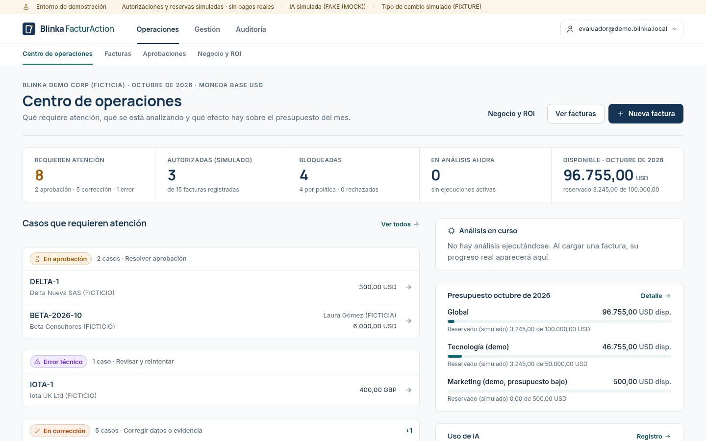
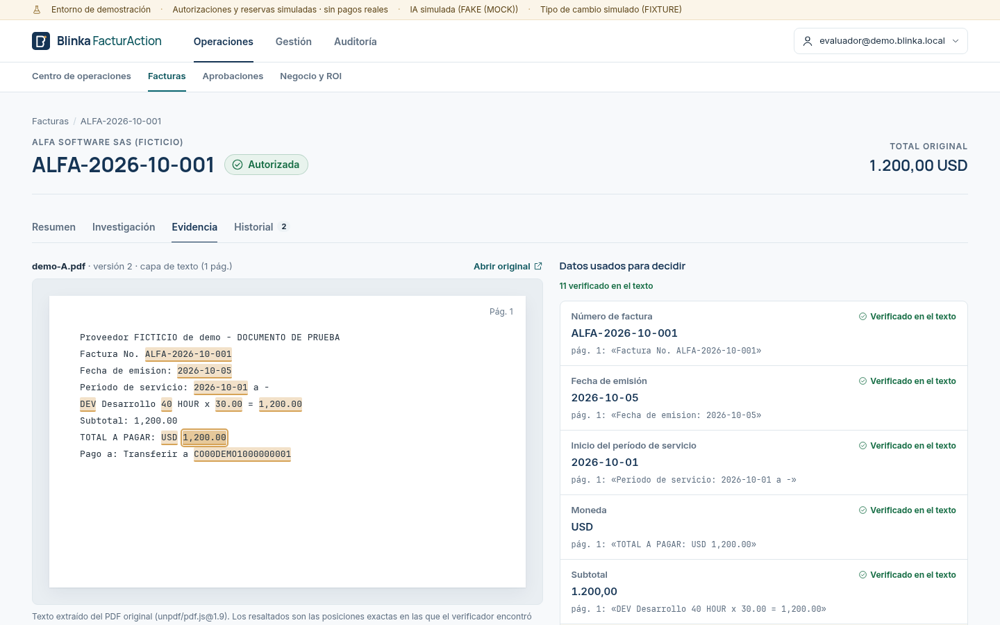
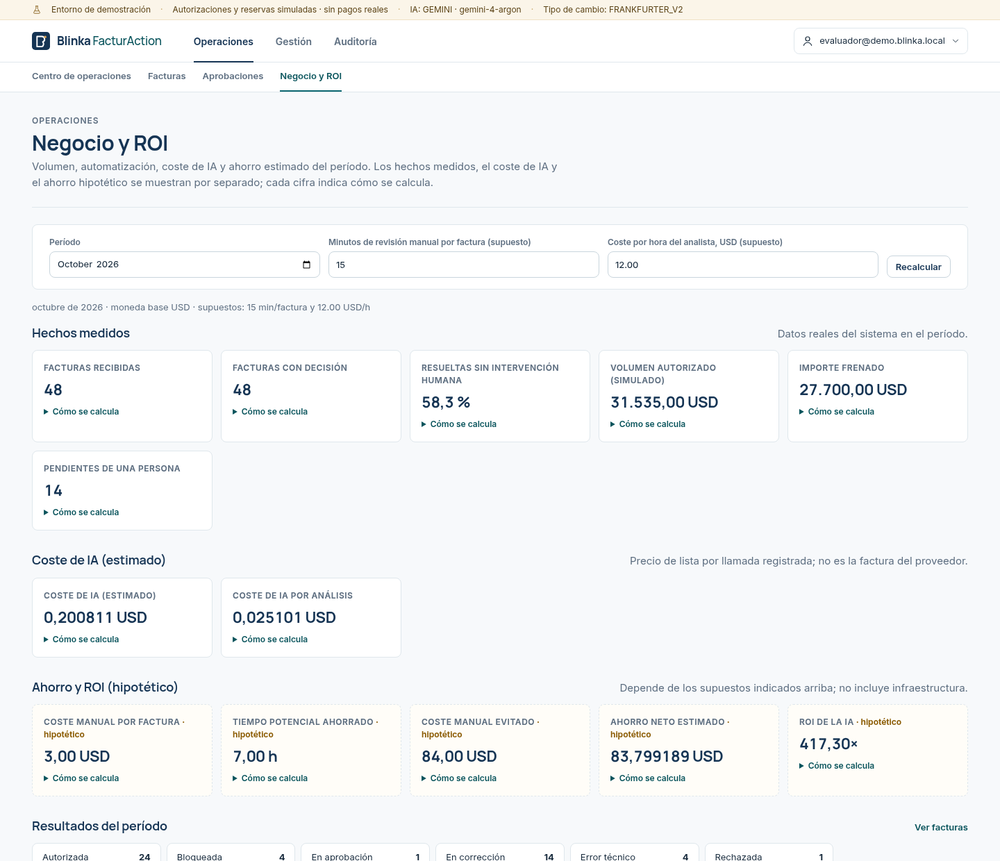
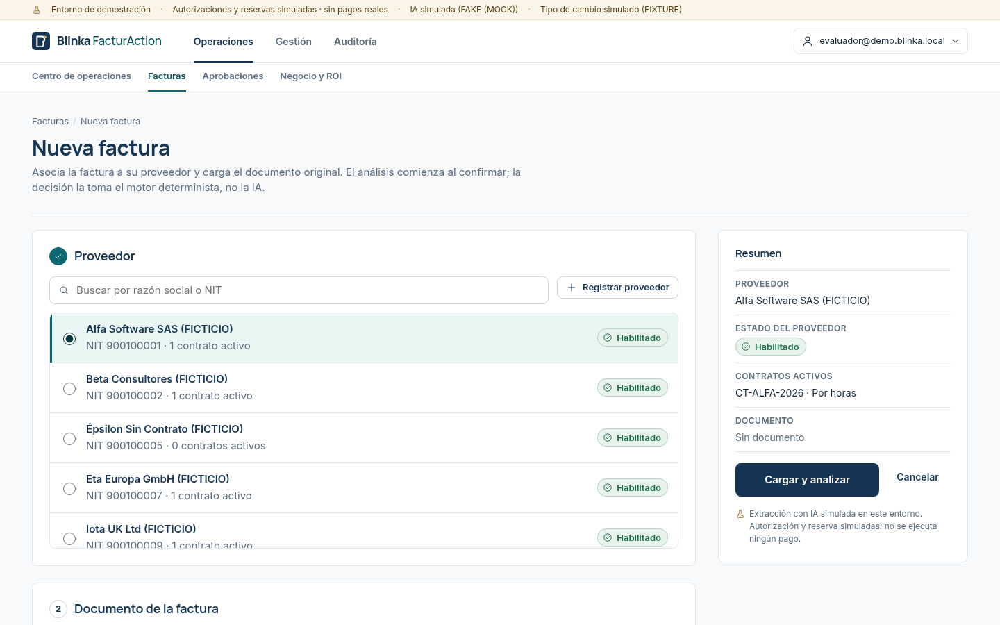
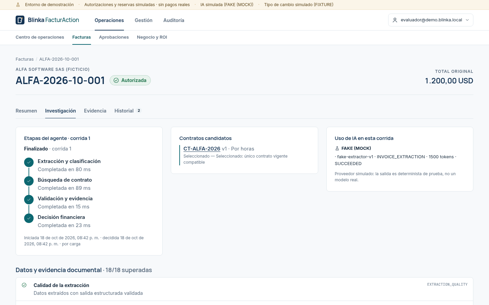
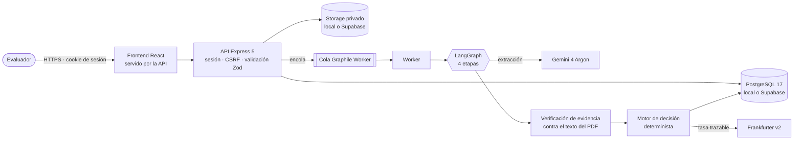

<div align="center">

# Blinka FacturAction

**Agente de cuentas por pagar que lee cada factura, la contrasta con el documento original, el contrato y las políticas de la empresa, y decide si se puede autorizar — explicando siempre por qué.**

[](#hackaton-30x--reto-blinka)
[](LICENSE)


> ⚠️ **Prototipo de hackatón.** Las autorizaciones, reservas de presupuesto y aprobadores son **simulados**: el sistema **nunca ejecuta pagos**. Todos los datos de la demo son **ficticios**.



</div>

> **English summary.** Blinka FacturAction is an accounts-payable AI agent built for the *Hackaton 30X — Blinka challenge* ("agents that pay on behalf of the company"). It extracts invoice data with Gemini, verifies every value against the original document text, the vendor contract and company policies, and lets a **deterministic rules engine** — never the AI — decide whether the invoice can be (simulated-)authorized, escalated or blocked. Full audit trail, AI cost tracking and an ROI dashboard included. Docs are in Spanish.

---

## ¿Qué problema resuelve?

En una empresa, cada factura de proveedor pasa por manos humanas antes de pagarse: hay que comprobar que el número no esté duplicado, que el importe cuadre con el contrato y con las horas o hitos pactados, que el proveedor y su cuenta estén habilitados, que haya presupuesto… Es un trabajo **lento, repetitivo y propenso a errores**, y un PDF manipulado o una factura duplicada pueden terminar en un pago indebido.

Blinka FacturAction automatiza esa revisión **sin quitarle el control a las personas**:

1. **Subes la factura** (PDF o imagen) y eliges el proveedor.
2. **La IA extrae los datos** (número, fechas, importes, líneas, cuenta de pago…).
3. **Cada dato se verifica contra el texto real del documento** y contra el contrato vigente: si la IA "ve" algo que no está en el PDF, se detecta.
4. **Un motor de reglas determinista decide** con políticas, topes, presupuesto y tipo de cambio — y explica cada verificación.

## Los seis resultados posibles

| Resultado | Qué significa |
|---|---|
| ✅ **Autorizada** | Todo cuadra: se autoriza y se reserva el presupuesto (simulado). |
| ⏳ **En aprobación** | Supera el límite automático o el proveedor está pendiente: decide una persona (aprobador simulado). |
| ✏️ **En corrección** | Faltan datos o hay una discrepancia con el documento o el contrato: hay que corregir, **nunca "aprobar de todos modos"**. |
| ⛔ **Bloqueada** | Incumple una regla obligatoria (duplicado, tope absoluto, presupuesto, proveedor bloqueado). |
| ❌ **Rechazada** | Una persona rechazó la aprobación (distinto de un bloqueo por política). |
| ⚠️ **Error técnico** | Falló un servicio (IA, tipo de cambio…): sin decisión financiera, se puede reintentar. |

## En qué ayuda y qué mejora

- **Menos revisión manual:** las facturas conformes se resuelven solas; las personas se concentran en las excepciones.
- **Cero autorizaciones sin evidencia:** cada valor usado para decidir está localizado en el documento (página y posición exacta).
- **La IA nunca decide sola:** solo extrae y propone; la decisión es de reglas auditables. Instrucciones maliciosas dentro del PDF se ignoran.
- **Trazabilidad completa:** versiones inmutables, cada verificación con su motivo, auditoría append-only de personas, sistema y agente.
- **Control de presupuesto y riesgo:** reservas mensuales globales y por categoría sin sobregiro, detección de duplicados, multimoneda con tasa trazable.
- **Coste visible:** cada llamada a la IA registra tokens y coste estimado; el panel **Negocio y ROI** compara coste de IA con ahorro estimado, con fórmulas a la vista.

<table>
<tr>
<td width="50%"><br><sub><b>Evidence Studio</b> — cada dato usado para decidir, resaltado en su posición exacta del documento.</sub></td>
<td width="50%"><br><sub><b>Negocio y ROI</b> — hechos medidos, coste de IA y ahorro hipotético, cada cifra con «cómo se calcula».</sub></td>
</tr>
<tr>
<td width="50%"><br><sub><b>Nueva factura</b> — proveedor obligatorio, estado y consecuencias visibles antes de cargar.</sub></td>
<td width="50%"><br><sub><b>Investigación</b> — etapas del agente, contrato elegido y cada verificación del motor.</sub></td>
</tr>
</table>

## Funcionalidades

| Área | Qué incluye |
|---|---|
| **Facturas** | Carga PDF/PNG/JPEG con proveedor obligatorio, progreso real del análisis, versiones y correcciones, confirmación humana para documentos escaneados, análisis masivo encolado |
| **Agente de IA** | LangGraph en 4 etapas (extracción, búsqueda de contrato, validación, decisión), herramientas de solo lectura, límites de pasos/tokens/tiempo, reintentos por etapa y recuperación automática |
| **Evidencia** | Verificación determinista de cada valor contra la capa de texto del PDF (página y caracteres) |
| **Reglas y finanzas** | Contratos por horas, recurrentes, por hitos y órdenes de compra; políticas versionadas con límites y matriz de aprobación; presupuestos mensuales con reserva; tipo de cambio Frankfurter (BCE/BanRep) |
| **Personas en el circuito** | Aprobaciones simuladas (aprobar ⇒ reevaluación completa), correcciones auditadas, sin "aprobar de todos modos" |
| **Gestión** | Proveedores y cuentas bancarias (huella HMAC, nunca el número completo), contratos, políticas, presupuestos, categorías |
| **Auditoría y costes** | Eventos append-only, uso de IA por llamada, etapa, modelo, día y factura |
| **Negocio y ROI** | Volumen autorizado, automatización, importe frenado, coste de IA por análisis y ROI con supuestos editables |

## ¿Qué es real y qué es simulado?

| Componente | Estado |
|---|---|
| Pagos, autorizaciones y reservas de presupuesto | **Simulados** — nunca se mueve dinero |
| Personas aprobadoras | **Simuladas** (ficticias) |
| Extracción con IA | **Real** con Gemini 4 Argon (verificado), o proveedor simulado para desarrollo y pruebas |
| Tipo de cambio | **Real** con Frankfurter v2, o tasas fijas para desarrollo |
| Base de datos y documentos | PostgreSQL local o **Supabase** (BD + Storage privado) |
| Datos de la demo | **Ficticios** |

---

## Arquitectura



- **Monorepo** con npm workspaces: `apps/backend` (Node.js + Express 5 + TypeScript; procesos **api** y **worker** del mismo código) y `apps/web` (React 19 + Vite).
- **El análisis es asíncrono:** la API encola y responde al instante; el worker ejecuta el grafo de LangGraph y el frontend sigue el progreso real por etapas.
- **La IA no tiene herramientas de escritura.** La decisión y la reserva de presupuesto ocurren en una transacción del motor determinista, con bloqueos que impiden sobregiros.
- **Dinero sin coma flotante:** importes como decimales exactos de extremo a extremo.

Detalle completo en [docs/guide/02-arquitectura.md](docs/guide/02-arquitectura.md).

| Capa | Tecnología |
|---|---|
| Backend | Node.js 24, Express 5, TypeScript, Zod, Drizzle ORM, PostgreSQL 17, Graphile Worker, LangGraph.js, unpdf |
| IA | Google Gemini 4 Argon (`generateContent`, salida estructurada, function calling) |
| Frontend | React 19, Vite, React Router, CSS Modules, GSAP (respeta movimiento reducido) |
| Infraestructura | Docker y Compose, Caddy (HTTPS), Supabase (PostgreSQL + Storage), Frankfurter v2 |
| Calidad | Vitest (≈ 300 pruebas), Testing Library, Playwright E2E, OpenAPI 3.1 |

## Inicio rápido (local, sin claves externas)

Requisitos: **Node.js ≥ 24.7** y **Docker**. Todo con IA y tipo de cambio simulados.

```bash
git clone <url-del-repositorio> Blinka_Agent && cd Blinka_Agent
npm ci
cp apps/backend/.env.example apps/backend/.env
#   → completa SEED_EVALUATOR_PASSWORD y ACCOUNT_FINGERPRINT_SECRET (openssl rand -base64 48)
npm run db:up            # PostgreSQL 17 en Docker (127.0.0.1:54329)
npm run db:migrate
npm run db:seed          # empresa y evaluador ficticios
npm run db:seed:demo     # 15 facturas de demostración
npm run dev:api          # http://localhost:4000      (terminal 1)
npm run dev:worker       # worker de análisis          (terminal 2)
npm run dev:web          # http://localhost:5173       (terminal 3)
npm run analyze:batch -- --api=http://127.0.0.1:4000   # analiza las 15 facturas
```

Entra en `http://localhost:5173` con `SEED_EVALUATOR_EMAIL` / `SEED_EVALUATOR_PASSWORD` de tu `.env`.

**Con Gemini real y Supabase**, o en **producción con Docker Compose + HTTPS**: ver [docs/guide/03-instalacion.md](docs/guide/03-instalacion.md).

```bash
REMOTE_DB_CONFIRM=<host>/<base> npm run start:cloud   # app completa local contra Supabase + Gemini
REMOTE_DB_CONFIRM=<host>/<base> npm run prod:up       # producción: api + worker + Caddy (HTTPS)
```

## Documentación

| Guía | Para quién |
|---|---|
| [01 · Producto](docs/guide/01-producto.md) | Cualquier persona: recorrido, resultados, evidencias, aprobaciones, presupuestos, ROI y escenarios de demo |
| [02 · Arquitectura](docs/guide/02-arquitectura.md) | Desarrolladores: módulos, agente, motor de decisión, modelo de datos |
| [03 · Instalación](docs/guide/03-instalacion.md) | Quien lo levanta: local, Gemini, Supabase, producción |
| [04 · Operación](docs/guide/04-operacion.md) | Operación: análisis masivo, costes, métricas, recuperación, pruebas |
| [05 · Seguridad](docs/guide/05-seguridad.md) | Técnicos y auditores: sesiones, aislamiento, secretos, IA segura |
| [API (OpenAPI 3.1)](docs/api/openapi.json) | También en `GET /openapi.json` |
| [Reportes de implementación](docs/implementation/) | Detalle de cada paquete, decisiones y verificaciones |

## Estructura del repositorio

```
apps/
  backend/     API + worker (Express, Drizzle, Graphile, LangGraph); migraciones en drizzle/
  web/         Frontend React + Vite; pruebas Vitest y Playwright
deploy/        Caddy (HTTPS) y Railway (preparado)
docker/        inicialización de PostgreSQL local
docs/
  guide/       guías públicas
  implementation/  reportes de implementación, decisiones, runbook
  api/         contrato OpenAPI
  assets/      imágenes del README
scripts/       lanzador start:cloud, auditoría de publicación, utilidades
supabase/      configuración de la CLI de Supabase
```

## Hackaton 30X · Reto Blinka

Proyecto desarrollado para la **Hackaton 30X**, reto **Blinka: «Agentes que pagan por la empresa»**. El objetivo del reto es un agente que gestione pagos a proveedores con criterio empresarial; esta solución se centra en que **ningún pago pueda autorizarse sin evidencia verificable, reglas explícitas y trazabilidad**, manteniendo a las personas en las decisiones que lo requieren. Todo el flujo financiero es una **simulación** pensada para demostrar el comportamiento del agente.

El producto se llamó *Blinka PayGuard AI* durante el desarrollo; las especificaciones de partida conservan ese nombre.

**Autor:** juan_garavito · desarrollado con asistencia de [Claude Code](https://claude.com/claude-code).

## Licencia

[MIT](LICENSE). Los nombres de empresas, proveedores y personas de la demo son ficticios.
