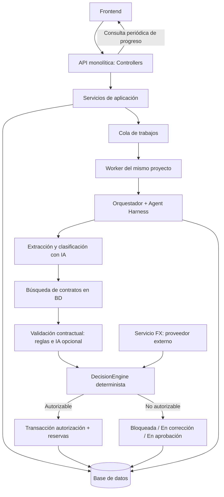

# Blinka PayGuard AI — Arquitectura lógica v1.1

**Proyecto:** Hackaton 30X · Reto Blinka  
**Fecha base:** 17 de octubre de 2026  
**Estado:** arquitectura lógica consolidada; decisiones confirmadas y proveedores tecnológicos pendientes de selección.  
**Base de datos:** Modelo entidad–relación v1.2 (31 entidades conceptuales).  
**Siguiente etapa:** selección de tecnologías; después UX/UI y finalmente contratos de API.

## 1. Decisiones ya confirmadas

| Código | Decisión |
|---|---|
| ARCH-001 | Monolito modular multicapa para gestión de empresas, proveedores, contratos, facturas, políticas, aprobaciones, presupuestos y auditoría; `Controllers`, `Services` y `Repositories`. |
| ARCH-002 | Módulo de agentes separado **lógicamente**, no como microservicio obligatorio. Orquestador y especialistas con harness común, herramientas y políticas particulares. |
| ARCH-003 | Procesamiento asíncrono mediante **workers del mismo monolito** que comparte código y base de datos con la API. |
| ARCH-004 | Reintentos limitados **por etapa**: persistir avances, reutilizar resultados todavía válidos, invalidar dependientes si cambian las entradas y permitir reintento manual seguro tras agotar intentos. |
| ARCH-005 | Defensa en profundidad: instrucciones de seguridad por especialista, allowlist de herramientas, controles del harness y autorización nuevamente comprobada en backend/repositorios. Sin SQL libre generado por agentes. |
| ARCH-006 | Progreso de análisis mediante **polling** del frontend a la API, sin WebSockets/SSE necesarios en P0. |
| ARCH-007 | Extracción y clasificación de modalidad de factura con IA; búsqueda contractual principalmente por consultas y filtros, y análisis de evidencias con IA solo si aporta valor. |
| ARCH-008 | Motor de decisiones financieras **determinista**, separado de la inferencia IA. Nunca herramientas de agente para autorizar, reservar, modificar políticas ni cuentas bancarias. |
| ARCH-009 | Una autorización y su compromiso presupuestario global y de categoría se confirman en **una sola transacción atómica e idempotente**. |
| ARCH-010 | Jev **fuera de P0**; solo posible evaluación posterior con métricas comparativas. |
| ARCH-011 | `agent_stage_runs` aprobado: registrar un intento por etapa, con huella de entradas y referencia opcional a intento reutilizado; los resultados de negocio residen en sus tablas originales. |
| ARCH-012 | Imputación confirmada: reservas en el **mes calendario local de la autorización simulada** usando `companies.timezone`, con presupuesto global y de categoría del mismo período. |

## 2. Vista general

**Despliegue conceptual:** una aplicación, una BD, proceso web/API y proceso worker; cola como mecanismo lógico. El motor de BD, backend, frontend, broker y servicio de IA se elegirán en la etapa de tecnologías. No implica contenedores individuales por agente, segunda API interna ni microservicios.

## 3. Límites de los módulos

| Módulo | Responsabilidad | Prohibición / límite |
|---|---|---|
| Companies/Users | Autenticación y contexto empresarial del evaluador | Aislamiento de empresa obligatorio en consultas y recursos. |
| Vendors/Contracts | Proveedores, cuentas autorizadas, contratos tipados y versiones confirmadas | Contratos de otro proveedor/empresa nunca se usan como evidencia. |
| Invoices/Documents | Carga, documentos privados, versiones, líneas y detección básica de duplicados | No editar versiones anteriores; facturas nuevas con nuevo número conservan identidad propia. |
| Agent | Orquestación, extracción, clasificación, selección de contratos y comparación asistida por IA | No autoriza, no reserva, no escribe políticas/cuentas, no emite SQL libre. |
| Policies/DecisionEngine | Reglas aplicables, matriz de aprobación, límites absolutos, motivos y prioridad | Cualquier bloqueo firme prevalece sobre correcciones y aprobaciones. |
| ExchangeRates | Obtener tasa externa, validar frescura y registrar `fx_rate_snapshots` | No inferir tasa por LLM ni usar una tasa inválida para autorizar. |
| Budgets/Authorization | Validación financiera final, operaciones de autorización y reservas atómicas | No aceptar un saldo precalculado por el agente; bloquear y recalcular en transacción. |
| Approvals | Solicitud y resolución humanas **simuladas** con reevaluación posterior | Un humano no puede anular una prohibición firme mediante aprobación simple. |
| Audit/AI Usage | Evaluaciones inmutables, checks, evidencias, versiones aplicadas, eventos y costes | No almacenar razonamiento privado del LLM ni secretos en logs. |

### 3.1. Agentes especializados: cuándo son agentes y cuándo son servicios

- **Extractor + clasificador:** componente asistido por LLM multimodal que devuelve campos estructurados y modalidad `RECURRING / HOURLY / MILESTONE / PURCHASE_ORDER / UNKNOWN / MIXED`; no inventa datos no encontrados.
- **Buscador contractual:** servicio especializado **determinista** con consultas parametrizadas sobre contratos del proveedor, filtrando tipo, vigencia y referencia. No requiere un LLM adicional por defecto.
- **Analizador contractual:** especialista de validación; coteja campos estructurados y obtiene evidencias; invoca IA únicamente cuando una cláusula o correspondencia semántica exige interpretación. Devuelve discrepancias y referencias de origen, no una autorización.
- **Orquestador:** principalmente código; aplica pasos y rutas condicionales, reintentos, límites y guardrails. No necesita un LLM supervisor para cada documento.

**Principio:** especialización de funciones sin pagar por una llamada LLM por cada nombre de agente.

## 4. Harness: controles reales por especialista

1. Contexto de ejecución confiable fijado por el backend: `company_id`, `invoice_id`, `invoice_version_id`, `evaluation_flow_id`; jamás aceptar que el LLM reemplace estos identificadores.
2. Herramientas autorizadas por especialista; el modelo solo entrega argumentos validados, no SQL ni credenciales.
3. Repositorios con comprobaciones `company_id` y pertenencia de proveedor/contrato/documento; consultas parametrizadas.
4. Facturas y contratos son datos **no confiables**. Ignorar instrucciones que aparezcan dentro del documento y nunca concederles prioridad sobre las políticas del sistema.
5. Formatos de respuesta tipados/validados, obligatoriedad de evidencia, `UNKNOWN` ante datos críticos ausentes.
6. Límites configurables por etapa de tokens, coste por ejecución, pasos, herramientas, tiempo y concurrencia. No se impone un cupo global de llamadas LLM en P0.
7. Logs mínimos con proveedor, modelo, tokens, coste estimado, herramientas y referencias de evidencia; proteger documentos y datos sensibles.
8. Las acciones de autorización, reserva, modificación de políticas y autorización de cuentas **no existen** en el catálogo de herramientas de los agentes.

## 5. Máquina de ejecución de un análisis

**Etapas transitorias (no son estados comerciales de factura):** `QUEUED → EXTRACTING → MATCHING → VALIDATING → DECIDING → FINISHED / FAILED_TECHNICAL`. Clasificar está incorporado en la etapa de extracción, evitando otra llamada por defecto.

**Estados comerciales visibles acordados:** `EN_APROBACION`, `EN_CORRECCION`, `BLOQUEADA`, `RECHAZADA`, `AUTORIZADA`, `ERROR`. Se obtienen como resultado de cada flujo/última evaluación relevante, no de los estados de cola.

- Un flujo puede producir varias ejecuciones (`evaluation_runs`) por reevaluación tras aprobación o nueva evidencia.
- Un flujo terminado en bloqueo no se reescribe: un intento posterior válido abre `evaluation_flow` nuevo relacionado por `previous_flow_id`.
- Una corrección de extracción de la misma factura crea `invoice_version` nuevo sin cambiar `invoice_id`.
- Si el emisor genera una **factura legal distinta** con nuevo número, se registra otro `invoice_id` y puede relacionarse con la anterior mediante `replaces_invoice_id`, respetando la prueba documental y controles de duplicidad.
- Las decisiones previas, candidatos, evidencias, políticas aplicadas y eventos permanecen auditables.

### 5.1. Reintentos por etapa

- Ante timeout, tasa temporal o fallo de conexión, reintentar **solo la etapa que falló**, usando backoff y número máximo configurable de intentos; valores concretos se fijan al elegir tecnologías.
- Reutilizar una etapa únicamente si coincide la huella de sus dependencias (versión de factura, versión de contrato y fuentes necesarias). Si cambia un documento, se invalidan extracción y derivadas; si cambia el contrato, se invalidan búsqueda/validación; toda autorización siempre revalida políticas, FX y presupuesto vigente.
- Un documento ilegible o dato crítico indeterminable corresponde a `EN_CORRECCION`; una indisponibilidad del proveedor de IA/FX corresponde a `ERROR` tras agotar recuperación segura.
- Reintento manual inicia un nuevo intento rastreable con la misma identidad de factura y evita duplicar obligaciones.
- Las operaciones de BD y reserva deben ser idempotentes aunque la cola entregue el mismo trabajo varias veces.

**Ajuste necesario al ER v1.2:** para cumplir reintentos persistentes y trazables por etapa sin guardar un único JSON opaco, se recomienda añadir **`agent_stage_runs`** (`id`, `evaluation_run_id`, `stage`, `attempt_no`, `status`, `input_fingerprint`, `started_at`, `finished_at`, `error_code`, `result_ref?`), vinculado a resultados estructurados existentes (`invoice_versions`, `evaluation_contract_candidates`, `evaluation_checks`, `ai_usage_logs`). Esto se consolidará como ER v1.2 durante el diseño físico. No es un nuevo agente ni un microservicio.

## 6. Autorización financiera e invariantes

### 6.1. Orden lógico de decisión

1. Obtener factura y versión, empresa, proveedor, cuenta, contrato y versión **confirmados**.
2. Validar identidad/duplicidad básica, autorizaciones de proveedor/cuenta, moneda y condiciones contractuales.
3. Obtener y validar tasa FX cuando importe y moneda base difieren; persistir snapshot verificable.
4. Aplicar todas las políticas vigentes (global + ámbito específico; la más estricta domina), límites absolutos y matriz de aprobaciones.
5. Si existe un incumplimiento **duro y verificado**, `BLOQUEADA`; si faltan datos o existe discrepancia corregible, `EN_CORRECCION`; si falta autorización humana, `EN_APROBACION`; si todo está conforme, autorización transaccional.
6. `ERROR` representa una interrupción técnica; `RECHAZADA` representa resolución humana negativa, no una prohibición automática.

### 6.2. Límite de transacción

**Recomendación de implementación obligatoria:** la operación final de autorización realiza de manera indivisible:

1. Validar idempotencia y bloquear la factura/obligación y los presupuestos mensual global y de categoría en **orden fijo**.
2. Revalidar que la factura no esté ya autorizada; la cuenta y contrato continúen autorizados/vigentes; que las políticas aplicables sean válidas; que la tasa FX usada siga admitida y que los saldos alcancen. Toda aprobación humana pendiente debe estar resuelta favorablemente, con nueva evaluación.
3. Crear **una** `budget_reservation` vinculada a factura y evaluación; registrar su efecto simultáneo en el presupuesto global y el de categoría, mediante `budget_reservation_allocations` del ER v1.2 (no equivalen a dos gastos).
4. Persistir resultado `AUTORIZADA`, comprobaciones y evento de auditoría; confirmar la transacción.
5. Ante cualquier fallo, rollback completo y ninguna reserva parcial.

**Restricciones mínimas:** `UNIQUE(invoice_id)` para reserva válida en P0, idempotency key por operación y unicidad de la identidad externa `(company_id, vendor_id, invoice_number_normalized)` cuando conocida. Las transacciones y locks son responsabilidad del backend/BD, nunca del agente.

**Período presupuestario CONFIRMADO:** las reservas se imputan al mes calendario local de la autorización simulada, calculado desde `authorized_at` y `companies.timezone`. Se verifican ambos presupuestos del **mismo mes** en una transacción. No se reserva presupuesto para solicitudes pendientes ni se trasladan reservas automáticamente entre meses en P0.

## 7. Polling, progreso y notificaciones

La API devuelve rápidamente un identificador de flujo/trabajo tras registrar y encolar. El frontend consulta su progreso **a intervalos razonables, configurables** y deja de consultar cuando el intento termina. El resultado informa una etapa de trabajo (`queued / extracting / matching / validating / deciding / finished / failed`) y, al finalizar, el **estado comercial** de la factura.

- El progreso es por **etapas verificadas**, no un porcentaje ficticio ni una transmisión del razonamiento interno del modelo.
- Cada consulta aplica autenticación, autorización y `company_id` del contexto seguro.
- Mientras la solicitud está `EN_APROBACION`, el worker **no queda esperando**; se cierra el intento y una respuesta humana inicia una reevaluación posterior.
- Los emails/mensajes de aviso pueden implementarse como servicio opcional o simulación; **no** son condición para completar un análisis en P0.
- Polling en P0. WebSockets/SSE fuera del núcleo; podrán añadirse sin alterar el modelo de decisiones.

## 8. Almacenamiento, tasas externas y política de errores

- Documentos privados referenciados desde `documents.storage_key`; la API entrega una URL temporal de acceso cuando el usuario autenticado está autorizado. Sin URLs públicas permanentes.
- Conversión FX la solicita el servicio financiero del backend, no un tool opcional del modelo. `fx_rate_snapshots` guarda pareja de monedas, tasa, proveedor y marcas de tiempo; transacciones financieras usan aritmética decimal.
- Si moneda desconocida, tipo contractual ambiguo o evidencia insuficiente: no autorizar; solicitar corrección. Si servicio de terceros está caído sin alternativa válida: `ERROR` recuperable.
- Tokenización, coste y proveedor/modelo por etapa en `ai_usage_logs`, sin cuotas globales arbitrarias del usuario.

## 9. Seguridad y alcance de la demo

- Una empresa ficticia P0, usuario evaluador autenticado, responsables de aprobaciones **simulados**, con roles de negocio en matriz pero sin separación real de usuarios.
- Comprobar autorización en backend tanto en endpoints como en tools; no confiar en campos arbitrarios del frontend ni del LLM.
- No transferencias reales, ni interacción con bancos; "autorización" y "reserva" son exclusivamente simulaciones internas.
- Aplicar protección básica de archivos, autenticación, límites de entrada razonables y concurrencia de trabajos; parámetros concretos se eligen en tecnologías.
- La arquitectura admite más empresas mediante `company_id` sin implementar un framework complejo de multi-tenancy en P0.

## 10. Criterios de aceptación de arquitectura

- [ ] No existe código o tool que permita a IA invocar directamente autorización/reserva.
- [ ] Se puede demostrar que una factura válida se autoriza y reserva global+categoría exactamente una vez.
- [ ] Dos workers compitiendo no pueden autorizar dos veces ni superar un presupuesto.
- [ ] Un fallo en validación contractual no repite la extracción si los insumos son idénticos.
- [ ] Cambios en entradas invalidan resultados obsoletos, sin borrar auditoría anterior.
- [ ] Una factura sin evidencia suficiente no se autoriza por alta puntuación/probabilidad del LLM.
- [ ] Polling muestra etapas y resultado, y se detiene tras finalizar el intento.
- [ ] Rechazo humano y bloqueo por política producen estados diferentes.
- [ ] Un flujo bloqueado anterior permanece intacto ante una reevaluación futura válida.

## 11. Pendiente de selección de tecnologías (no bloquea el cierre lógico)

1. Lenguaje/framework de la API, motor de BD, librería de acceso a datos y estrategia de transacciones.
2. Implementación de cola de trabajos: infraestructura real mínima, reintentos/backoff, límite de concurrencia y recuperación de trabajos perdidos.
3. Proveedor y modelo multimodal, estrategia de extracción y política de coste/tokens por etapa.
4. Proveedor de tasas FX y regla exacta de vigencia/frescura.
5. Almacenamiento de documentos, protección de archivos, autenticación y despliegue.
6. Frecuencia de polling (valor operativo) y mecanismo de aviso opcional.

**Decisiones de arquitectura cerradas:** reintentos por etapa respaldados por `agent_stage_runs` y período presupuestario local de autorización confirmados. La estrategia de autenticación y los proveedores externos concretos se resolverán al seleccionar tecnologías.

## 12. Resultado

La arquitectura lógica queda **consolidada como base de diseño**: monolito modular multicapa, especialistas dentro de `Agent`, harness con defensa en profundidad, workers asíncronos, recuperación por etapa, polling, decisión financiera determinista y autorización/reserva atómica. El siguiente entregable será la selección justificada de tecnologías. El ER v1.2 ya incorpora los checkpoints por etapa y la imputación mensual confirmada.
