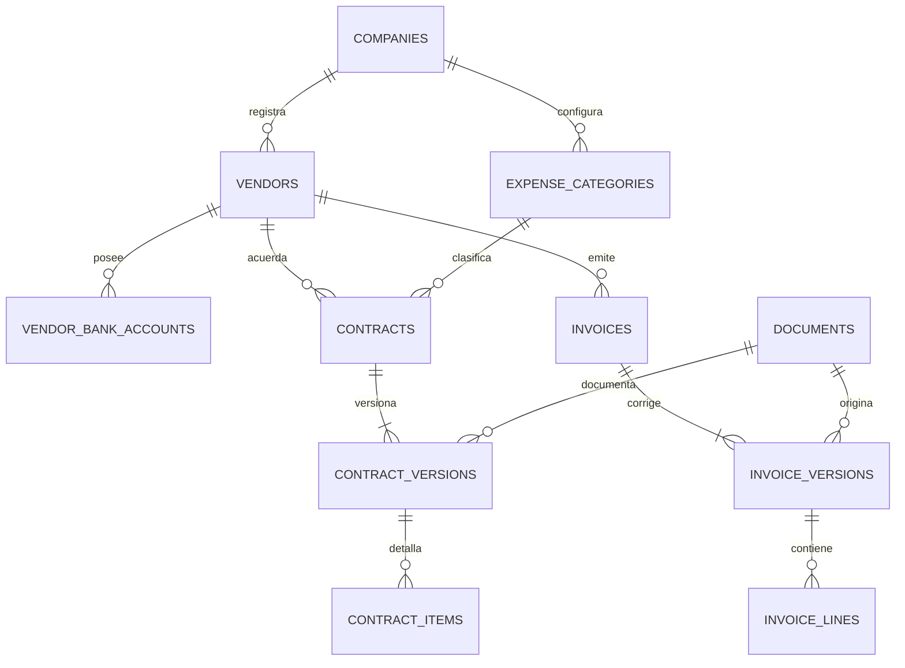
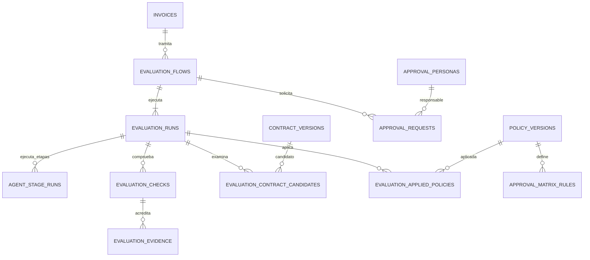
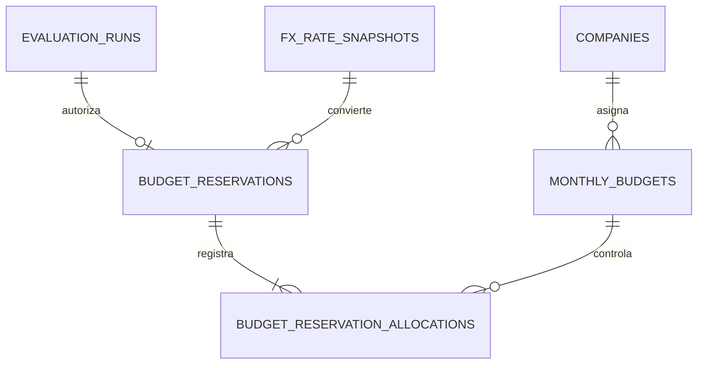

# Blinka PayGuard AI — Modelo entidad–relación v1.2

**Proyecto:** Hackaton 30X · Reto Blinka  
**Fecha:** 17 de octubre de 2026  
**Estado:** baseline lógico consolidado con decisiones confirmadas; no es aún un esquema físico ni contiene migraciones.

> Este documento sustituye como base de revisión al ER v1.0. Distingue reglas **confirmadas** de **supuestos de diseño**. Las tecnologías, las API y la interfaz se diseñarán después, según el orden acordado.

## 1. Veredicto y alcance

El **modelo conceptual y el inventario de entidades quedan suficientemente definidos para comenzar arquitectura**. No es necesario abrir más cuestionarios funcionales antes de diseñar componentes. El ER lógico se consolida como baseline de diseño; sus invariantes se verificarán con migraciones y pruebas durante la implementación. El ER v1.0 no debe marcarse «final» porque aún contiene estructuras descartadas y campos críticos en JSON.

**Alcance P0:** una empresa ficticia, acceso autenticado de evaluador, aprobadores simulados, proveedores con varias cuentas, cuatro tipos de acuerdo, facturas versionadas, seis estados visibles, decisiones deterministas, políticas, presupuestos global y por categoría mensuales, tasas externas auditablemente registradas, reserva simulada atómica, auditoría y registro de uso IA. **Sin pagos reales ni anulación de autorizaciones.**

**Principio de diseño confirmado:** los datos críticos y las asociaciones se expresan con tablas, tipos y claves foráneas. JSON solo para respuestas crudas de IA y metadatos técnicos auxiliares, nunca para sustituir condiciones financieras obligatorias.

## 2. Cambios frente al ER v1.0

| Decisión | Cambio incorporado hasta v1.2 |
|---|---|
| Duplicados P0 | Se elimina `invoice_identity_keys`; identidad primaria lógica: empresa + proveedor + número normalizado. |
| Aprobaciones | Se elimina `approval_resolutions`; `approval_requests` contiene estado y datos de resolución, con evento de auditoría inmutable. |
| Matriz de aprobación | Se añade `approval_matrix_rules`, vinculada a versiones de política y a `approval_personas`. |
| Auditoría contractual | Se mantienen `evaluation_contract_candidates`, `evaluation_checks`, `evaluation_evidence` y `evaluation_applied_policies` como tablas relacionales. |
| Monedas | `fx_quotes` pasa a `fx_rate_snapshots`; tasas obtenidas por un servicio del backend desde una API externa, o fuente simulada inequívocamente marcada. |
| Datos contractuales | Se reemplaza `contract_versions.structured_terms` por columnas tipadas y detalles en `contract_items`, sin valores financieros obligatorios escondidos en JSON. |
| Políticas | Se reemplaza `policy_versions.conditions` por límites tipados y reglas de aprobación explícitas. |
| Documentos | `documents.storage_key` identifica archivo privado; no guardar URL pública permanente. |
| Presupuesto | Se conservan `budget_reservations` y `budget_reservation_allocations` por trazabilidad referencial (dos asignaciones: global y categoría), sin confundirlas con dos gastos. |
| Categoría | `contracts.category_id` propone el destino presupuestario; `invoices.category_id` debe coincidir con el contrato validado antes de autorizar. |
| Ejecución asíncrona | Se añade `agent_stage_runs` para intentos por etapa, resultados reutilizados y fallos técnicos con trazabilidad. |
| Imputación mensual confirmada | La reserva se contabiliza en el mes local de la autorización simulada según `companies.timezone`, no en el mes de carga ni vencimiento de factura. |

**Conteo:** 31 entidades conceptuales (30 en v1.1, más `agent_stage_runs`). Es un **inventario lógico**: no implica que todas requieran formularios, endpoints o pantallas individuales para el P0.

## 3. Catálogo de entidades

### A. Empresas, usuarios y categorías (5)

| Tabla | Claves y campos principales | Responsabilidad y control |
|---|---|---|
| `companies` | `id PK`, `name`, `base_currency`, `timezone`, `status` | Moneda base configurable, zona horaria para período mensual. No cambiar moneda base tras crear reservas sin procedimiento formal. |
| `users` | `id PK`, `email UNIQUE`, `password_hash`, `active` | Una cuenta autenticada de evaluador en demo. |
| `company_users` | `company_id FK`, `user_id FK`, `active`; UNIQUE(company_id,user_id) | Membresía y aislamiento para crecimiento; en P0 existe una membresía. No equivale a RBAC completo. |
| `expense_categories` | `id PK`, `company_id FK`, `code`, `name`, `active` | Una categoría presupuestaria por contrato/factura en P0. UNIQUE(company_id,code). |
| `approval_personas` | `id PK`, `company_id FK`, `display_name`, `designation`, `active` | Personas y cargos de aprobadores **simulados**, separados del usuario autenticado real. |

### B. Proveedores, documentos y acuerdos (6)

| Tabla | Claves y campos principales | Responsabilidad y control |
|---|---|---|
| `vendors` | `id PK`, `company_id FK`, `legal_name`, `tax_reference`, `status` | `PENDING/AUTHORIZED/BLOCKED`; identidad distinta de las cuentas. |
| `vendor_bank_accounts` | `id PK`, `company_id FK`, `vendor_id FK`, `country`, `currency`, `account_fingerprint`, `status` | Varias cuentas, autorización independiente; sin beneficiarios terceros P0. |
| `documents` | `id PK`, `company_id FK`, `kind`, `storage_key`, `original_name`, `mime_type`, `sha256`, `created_at` | Referencia al archivo privado original; enlace de descarga temporal generado en backend. |
| `contracts` | `id PK`, `company_id FK`, `vendor_id FK`, `category_id FK`, `contract_ref`, `billing_type`, `status` | `RECURRING/HOURLY/MILESTONE/PURCHASE_ORDER`; categoría sugerida por contrato. |
| `contract_versions` | `id PK`, `contract_id FK`, `version_no`, `currency`, `effective_from`, `effective_to`, `billing_frequency?`, `fixed_period_amount?`, `quantity_cap_per_period?`, `confirmed_by FK?`, `confirmed_at`, `source_document_id FK?`, `status` | Versión inmutable. Solo confirmada/activa autoriza. Campos opcionales tipados controlados por modalidad del contrato. |
| `contract_items` | `id PK`, `contract_version_id FK`, `code`, `description`, `item_kind`, `unit`, `agreed_quantity?`, `unit_price?`, `milestone_ref?`, `agreed_amount?` | Tarifas de horas, artículos de OC y entregables. Evidencia de cumplimiento se vincula a validaciones. |

**Validación por modalidad:** recurrente usa frecuencia/importe/período; horas usa unidad/tarifa/cantidad permitida y respaldo; entregables usa hito/importe/evidencia de aceptación; OC usa referencia/artículo/cantidad/precio. No todos los campos aplican a todos los tipos. En arquitectura se fijarán validadores tipados por modalidad, no un JSON libre.

### C. Facturas y versiones (3)

| Tabla | Claves y campos principales | Responsabilidad y control |
|---|---|---|
| `invoices` | `id PK`, `company_id FK`, `vendor_id FK`, `category_id FK?`, `invoice_number_normalized?`, `current_version_id FK?`, `replaces_invoice_id FK?`, `created_at` | Identidad **interna** estable, número normalizado único por empresa+proveedor cuando conocido. Nueva factura legal: otro `id`; sustitución opcionalmente vinculada. |
| `invoice_versions` | `id PK`, `invoice_id FK`, `version_no`, `source_document_id FK`, `supplier_invoice_number`, `issue_date`, `due_date`, `service_period_start?`, `service_period_end?`, `original_currency`, `subtotal`, `taxes`, `discounts`, `total_amount`, `payment_destination_raw?`, `created_at` | Datos extraídos/corregidos de la misma factura comercial. Original y correcciones inmutables. |
| `invoice_lines` | `id PK`, `invoice_version_id FK`, `line_no`, `concept`, `quantity?`, `unit?`, `unit_price?`, `subtotal`, `tax_amount?` | Conceptos por versión: insumo de cotejo contractual. UNIQUE(invoice_version_id,line_no). |

**Duplicado P0:** cotejo por `(company_id, vendor_id, invoice_number_normalized)` más consulta de expedientes/versiones previas. No prometer detectar exhaustivamente facturas **con números distintos** de una misma obligación: el control adicional proviene del contrato, período e hitos, y las coincidencias inciertas requieren corrección, jamás aprobación por presunción. La unicidad debe existir en BD y el motor de autorización debe ser idempotente.

### D. Flujos, evaluaciones y fuentes (6)

| Tabla | Claves y campos principales | Responsabilidad y control |
|---|---|---|
| `evaluation_flows` | `id PK`, `company_id FK`, `invoice_id FK`, `previous_flow_id FK?`, `trigger_type`, `justification`, `opened_at`, `terminal_status?`, `closed_at?` | Un trámite. Flujos finalizados permanecen inalterados; reintento posterior abre nuevo flujo relacionado. |
| `agent_stage_runs` | `id PK`, `evaluation_run_id FK`, `stage_code`, `attempt_no`, `status`, `input_fingerprint`, `reused_from_stage_run_id FK?`, `started_at?`, `finished_at?`, `error_code?` | Un intento técnico de una etapa (extracción/clasificación, búsqueda, validación contractual, decisión). Permite reintentos acotados, checkpoints auditables y reutilización si coincide la huella de entradas. |
| `evaluation_runs` | `id PK`, `flow_id FK`, `invoice_version_id FK`, `run_no`, `detected_billing_type`, `selected_contract_version_id FK?`, `matched_bank_account_id FK?`, `fx_rate_snapshot_id FK?`, `decision`, `visible_outcome`, `reason_code`, `evaluated_at` | Una ejecución inmutable; **no** puede emitir autorización sin contrato válido y sin reserva confirmada. |
| `evaluation_contract_candidates` | `id PK`, `evaluation_run_id FK`, `contract_version_id FK`, `type_match`, `reference_match`, `selected`, `reason` | Opciones identificadas del proveedor; selección se comprueba por tipo, concepto, período, tarifa y evidencia. |
| `evaluation_checks` | `id PK`, `evaluation_run_id FK`, `rule_code`, `outcome`, `observed_text?`, `expected_text?`, `observed_amount?`, `expected_amount?`, `currency?`, `reason` | Una comprobación por regla, con resultado `PASS/FAIL/UNKNOWN`, valores estructurados y motivación. |
| `evaluation_evidence` | `id PK`, `evaluation_run_id FK`, `evaluation_check_id FK?`, `contract_candidate_id FK?`, `document_id FK?`, `source_field?`, `page_number?`, `clause_ref?`, `excerpt?`, `verification_status` | Procedencia concreta de cada comprobación/candidato; verificar que referencias pertenecen a la misma empresa y evaluación. |

**Contrato de etapas P0:** `stage_code` ∈ `EXTRACT_CLASSIFY`, `CONTRACT_MATCH`, `CONTRACT_VALIDATE`, `FINANCIAL_DECISION`; `status` ∈ `QUEUED`, `RUNNING`, `SUCCEEDED`, `FAILED`, `REUSED`. La restricción `UNIQUE(evaluation_run_id, stage_code, attempt_no)` impide numeraciones duplicadas. `reused_from_stage_run_id` apunta al intento con salida reutilizable, pero los resultados financieros siempre se recalculan/revalidan antes de la autorización. Si cambia una dependencia, la huella deja de coincidir: se crea otro intento y el anterior permanece históricamente intacto. Las salidas estructuradas viven en las entidades correspondientes; esta tabla registra **ejecución**, no copia documentos ni presupuestos. Los estados transitorios se actualizan durante el procesamiento; al finalizar el intento se consideran históricos y no se sobreescriben.

### E. Aprobaciones simuladas (1)

| Tabla | Claves y campos principales | Responsabilidad y control |
|---|---|---|
| `approval_requests` | `id PK`, `flow_id FK`, `requested_by_run_id FK`, `persona_id FK`, `status`, `requested_at`, `resolved_at?`, `resolved_by_user_id FK?`, `resolution_reason?` | Unifica solicitud y respuesta. `PENDING/APPROVED/REJECTED`. Respuesta queda además en `audit_events`; `APPROVED` exige nueva evaluación, `REJECTED` genera estado **RECHAZADA**, distinto de bloqueo. |

### F. Políticas y matriz versionada (4)

| Tabla | Claves y campos principales | Responsabilidad y control |
|---|---|---|
| `company_policies` | `id PK`, `company_id FK`, `scope_level`, `category_id FK?`, `vendor_id FK?`, `contract_id FK?`, `name`, `active` | Niveles empresa/categoría/proveedor/contrato; aplicar todos los correspondientes. |
| `policy_versions` | `id PK`, `policy_id FK`, `version_no`, `effective_from`, `auto_approval_limit_base?`, `hard_invoice_cap_base?`, `published_at` | Condiciones financieras **tipadas**. La regla específica nunca relaja una global. |
| `approval_matrix_rules` | `id PK`, `policy_version_id FK`, `min_amount_exclusive`, `max_amount_inclusive`, `persona_id FK`, `active` | Rangos en moneda base para responsables simulados. No permitir intervalos solapados dentro de la matriz vigente aplicable. |
| `evaluation_applied_policies` | `evaluation_run_id FK`, `policy_version_id FK`, `applicability_reason` | Relación N:M de versiones inmutables realmente aplicadas por evaluación. |

**Default P0:** una matriz empresarial de aprobación por rangos; las políticas de categoría, proveedor y contrato pueden endurecer los importes o bloquear. No implementar un sistema RBAC real con los aprobadores ficticios.

### G. Cambio de divisa y presupuestos (4)

| Tabla | Claves y campos principales | Responsabilidad y control |
|---|---|---|
| `fx_rate_snapshots` | `id PK`, `from_currency`, `to_currency`, `rate`, `provider`, `provider_reference?`, `rate_timestamp`, `fetched_at`, `valid_until?`, `is_simulated` | Registro inmutable de tasa consultada por servicio FX del backend. Nunca generada por LLM; base=origen implica tasa 1. |
| `monthly_budgets` | `id PK`, `company_id FK`, `category_id FK?`, `period_yyyy_mm`, `scope GLOBAL/CATEGORY`, `limit_base`, `reserved_base`, `currency` | Global y por categoría en moneda base; unicidad por ámbito/mes. `reserved_base` es saldo materializado reconciliable. |
| `budget_reservations` | `id PK`, `company_id FK`, `invoice_id FK`, `authorizing_run_id FK`, `fx_rate_snapshot_id FK?`, `original_amount`, `original_currency`, `reserved_amount_base`, `base_currency`, `idempotency_key`, `authorized_at`, `created_at` | Compromiso simulado por factura autorizada; UNIQUE(invoice_id), UNIQUE(company_id,idempotency_key). `authorized_at` determina el mes presupuestario local de ambas asignaciones. |
| `budget_reservation_allocations` | `id PK`, `reservation_id FK`, `monthly_budget_id FK`, `amount_base` | Exactamente dos asociaciones P0: una global y una de categoría, por la **misma** cantidad de compromiso; no son gastos adicionales. |

**Regla mensual confirmada:** los presupuestos global y de categoría se expresan por mes calendario en la moneda base de la empresa. Al autorizar se identifica el mes `YYYY-MM` con el instante `authorized_at` y la zona horaria `companies.timezone`. Las dos asignaciones de la reserva apuntan a presupuestos de ese **mismo mes**; una factura emitida en un mes anterior se imputa al mes de autorización en P0, sin traslado automático ni reservas de facturas todavía pendientes.

**Regla financiera:** conversión en backend (importe destino = importe origen × tasa), usando precisión decimal y criterio de redondeo controlado. Autorización debe verificar y actualizar ambos presupuestos, crear una reserva y dos asignaciones **en una sola transacción**. Si falla algo, nada se confirma. Si la API FX falla sin tasa utilizable, error técnico; si falta moneda o evidencia contractual, EN_CORRECCION.

### H. Auditoría y consumo IA (2)

| Tabla | Claves y campos principales | Responsabilidad y control |
|---|---|---|
| `audit_events` | `id PK`, `company_id FK`, `actor_kind`, `actor_ref`, `event_type`, `entity_type`, `entity_ref`, `occurred_at`, `details?` | Registro append-only de acciones humanas y del sistema. `details` solo metadatos no críticos; las relaciones y decisiones importantes son FKs/tablas. |
| `ai_usage_logs` | `id PK`, `company_id FK`, `evaluation_run_id FK?`, `contract_version_id FK?`, `task_type`, `provider`, `model`, `input_tokens`, `output_tokens`, `estimated_cost_usd`, `status`, `created_at` | Seguimiento de coste y tokens de extracción/contratos. No contiene prompts secretos ni razonamiento oculto. |

## 4. Diagramas ER por dominios

### 4.1. Proveedores, contratos, facturas

### 4.2. Evaluaciones, evidencias, aprobaciones

### 4.3. Presupuestos, FX y reservas

## 5. Relaciones e invariantes críticas

1. **Aislamiento:** todas las FKs de entidades empresariales deben mantener el mismo `company_id`; en diseño físico usar referencias compuestas o validación transaccional que impida relaciones cruzadas.
2. **Identidad:** `invoices.id` es estable; cada cambio interno crea `invoice_versions` y, cuando corresponda, nuevo `evaluation_flow`. Nueva factura legal con otro número crea `invoice` nuevo, opcionalmente `replaces_invoice_id` y documentación que acredita la sustitución.
3. **Duplicados:** clave única del número normalizado por empresa/proveedor cuando existe; antes de autorizar consultar registros de versiones y contratos/períodos pertinentes. **Limitación documentada:** coincidencias con números fiscales diferentes pueden requerir revisión humana; no se promete detector semántico avanzado en P0.
4. **Búsqueda contractual:** solo contratos del proveedor; identificar tipo facturado → candidatos del mismo tipo → comparar vigencia, tarifas, moneda, cantidades y referencias; ambiguos/no respaldados → EN_CORRECCION.
5. **Categoría:** el contrato validado identifica la categoría presupuestaria. Si la categoría asignada en la factura difiere, no autorizar hasta resolver la discrepancia.
6. **Políticas:** aplicación acumulativa por empresa/categoría/proveedor/contrato; la más restrictiva domina; versiones inmutables y asociación explícita por evaluación.
7. **Matriz humana:** designación de `approval_personas` simulada; un único usuario autenticado registra acciones, nunca suplantar una separación real de deberes.
8. **Resultados:** motor AUTHORIZE/BLOCK/ESCALATE; seis estados visibles: EN_APROBACION, EN_CORRECCION, BLOQUEADA, RECHAZADA, AUTORIZADA, ERROR. ERROR es técnico, RECHAZADA es humano, BLOQUEADA es política dura.
9. **Presupuestos:** una reserva y exactamente dos asignaciones del mismo importe en una transacción con bloqueos de fila y verificaciones de concurrencia, ambas del mes local de `authorized_at`; ninguna factura pendiente/rechazada/bloqueada consume presupuesto.
10. **Historia:** evaluaciones, documentos, versiones, evidencias, snapshots de FX y eventos de auditoría no se sobrescriben tras finalizar. Cambios de estado de solicitudes quedan auditados.
11. **Ejecución por etapa:** por cada intento técnico se registra `agent_stage_runs` con `stage_code` y `attempt_no` únicos por ejecución, estado y huella de entradas. Cuando se reusa una etapa, se referencia el intento reutilizado y se verifica igualdad de huella; fallas/reintentos no pueden crear una segunda autorización. Resultados históricos terminados no se sobrescriben cuando cambian insumos.
12. **Sin pagos:** AUTORIZADA significa autorización y reserva **simuladas**, sin transferencias reales ni reversiones en P0.

## 6. Supuestos operativos que NO bloquean arquitectura

- **Período presupuestario confirmado:** mes local de la **autorización simulada**, en zona horaria `companies.timezone`, no mes de emisión ni vencimiento de factura. No existe traslado automático de presupuestos entre meses en P0.
- **Vigencia FX:** configurar un máximo de antigüedad aceptable para el proveedor elegido. En la demo se podrán usar respuestas simuladas y rotuladas. La selección del proveedor y umbral exacto se hará en fase de tecnologías.
- **Disponibilidad de documentos:** una versión de contrato puede tener un documento principal; anexos de evidencia se conservan en `documents` y se referencian desde `evaluation_evidence`. Soporte completo de múltiples anexos permanentes por versión contractual puede añadirse con tabla puente si llega a necesitarse.
- **Estado de factura al cargarla:** mientras un trabajo está en cola o procesando se muestra actividad técnica en `agent_stage_runs`, no un séptimo estado financiero; el frontend utiliza polling para consultar el avance.
- **Tasa y precios:** se fija el modo de redondeo conservador y precisión de DECIMAL al seleccionar tecnología/BD, sin utilizar floats binarios.

## 7. Checklist de aceptación para cerrar diseño lógico

- [x] Tabla única `approval_requests` para solicitud y respuesta.
- [x] Diferenciar RECHAZADA, BLOQUEADA y ERROR.
- [x] Matriz relacional `approval_matrix_rules` y aprobadores simulados en `approval_personas`.
- [x] Búsqueda contractual automática y evidencia por candidato/validación.
- [x] Tablas relacionales de checks, evidencias y políticas aplicadas.
- [x] Control básico de duplicados sin `invoice_identity_keys`.
- [x] Presupuesto global/categoría y reserva dual atómica.
- [x] FX por servicio externo, snapshot auditable y moneda base por empresa.
- [x] Seis estados y versiones inmutables de factura/contrato/políticas.
- [x] Reintentos y checkpoints por etapa en `agent_stage_runs` (una fila por intento) y monitoreo por polling.
- [x] Imputación presupuestaria al mes local de la autorización simulada.
- [x] **Baseline lógico ER v1.2** actualizado con `agent_stage_runs` y período mensual ratificado.
- [ ] **Pruebas de esquema físico** (migraciones, claves compuestas/índices parciales, concurrencia), dentro de la fase de implementación, no un bloqueante de arquitectura.

## 8. Qué continúa, en el orden acordado

1. **Cerrar ER v1.2:** aceptar o corregir este documento maestro y registrar los supuestos propuestos. 
2. **Arquitectura lógica:** flujo de datos, módulos, almacenamiento privado, cola de análisis, orquestación IA, motor de reglas, FX y transacción de autorización/reserva.
3. **Tecnologías:** backend, frontend, base de datos, proveedor/modelo IA, FX API, almacenamiento y despliegue.
4. **UX/UI:** navegación, diseño de facturas, contratos, decisiones, aprobaciones y trazas.
5. **Contratos de API:** endpoints, DTO, eventos, idempotencia, OpenAPI y errores.

**Conclusión:** el modelo lógico v1.2 incorpora `agent_stage_runs` y la imputación mensual confirmada. Se adopta como base consolidada para seleccionar tecnologías y preparar el diseño físico, sujeto a pruebas de integridad, concurrencia e idempotencia durante la implementación.
