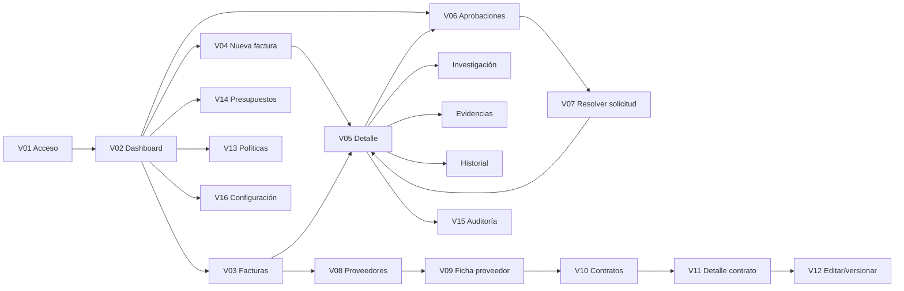

# BLINKA PAYGUARD AI
## Especificación integral de UX/UI: pantallas, navegación, movimiento y libertad de diseño — v1.0

**Proyecto:** Hackaton 30X / Blinka PayGuard AI  
**Fecha:** 18 de octubre de 2026  
**Estado:** brief de producto y experiencia para orientar a Claude. Define comportamientos y contenido esencial, **no layouts pixel-perfect ni contratos de API**.  
**Artefacto de destino:** React + Vite + JavaScript, GSAP para interacciones significativas.  
**Revisar junto con:** `Blinka_PayGuard_AI_Reglas_Diseno_v2_1.md`, `Blinka_PayGuard_AI_Modelo_ER_v1_2.md`, `Blinka_PayGuard_AI_Arquitectura_Logica_v1_1.md`, `blinka_fase0_especificacion_v0_4.md` y `Blinka_PayGuard_AI_Plan_Backend_para_Claude_v1_0.md`.

> **Instrucción principal para Claude:** diseñar una aplicación financiera B2B reconocible y usable, no copiar literalmente los wireframes exploratorios. Tienes libertad para proponer la composición de cada vista, microinteracciones, tipografías dentro de la guía y jerarquía espacial; **no** tienes libertad para cambiar las reglas financieras, los estados, los datos obligatorios o las restricciones de seguridad. Antes de codificar interfaces completas, presentar un mapa de navegación y una propuesta de 2–3 vistas clave para validación. El backend puede desarrollarse en paralelo.

---

# 0. Cómo interpretar este documento

## 0.1. Jerarquía de decisiones

1. **Funcionalidad y seguridad financiera:** modelo ER v1.2, especificación funcional y arquitectura lógica. Ganan en cualquier conflicto.
2. **Identidad visual aprobada:** reglas de diseño v2.1. Ganan frente a mockups anteriores y ejemplos decorativos de este documento.
3. **Este documento:** define el contenido y flujo UX esperado para cada pantalla, navegación y comportamiento animado.
4. **Libertad creativa de Claude:** decide la disposición concreta, proporciones, espaciado, composición, tratamientos visuales, variantes desktop/móvil y refinamientos de interacción, **siempre que preserve los puntos 1–3**.
5. **Mockups antiguos v1.0 y Dashboard v2.0:** exploraciones y catálogos de componentes; **no** layouts obligatorios. La imagen reciente con numerosos módulos juntos se considera un **UI Style Guide/Component Showcase**, no un dashboard que debamos copiar.

## 0.2. Qué está cerrado y qué es propuesta

**Cerrado:** aplicación interna tipo herramienta, no landing; navegación horizontal con pocos grupos y pestañas contextuales; lienzo luminoso; marca azul `#153454`, petróleo `#0D6871`, dorado `#D6A357`; sin azul eléctrico; sin sidebar permanente; sin intro animada; GSAP solo cuando aporta valor; seis estados financieros; autorización y reservas **simuladas**; proveedor seleccionado al cargar factura; trabajo asíncrono con polling; agente con evidencias y motor de reglas determinista.

**Propuesta ajustable por Claude:** ubicación de buscador, nomenclatura amigable de títulos, distribución en columnas, presencia de panel contextual, orden de módulos del Dashboard, detalles de tipografía, formatos de menú y dónde sustituir una transición por otra equivalente. Explicar los cambios propuestos antes de aplicarlos.

**No decidido aquí:** DTO, endpoints HTTP definitivos, librería de enrutamiento, librería de formularios, proveedor de iconos, componentes UI externos, breakpoints exactos y stack de pruebas visuales. Claude puede recomendar alternativas, pero no introducir grandes dependencias sin justificarlo.

## 0.3. Alcance y experiencia objetivo

- Una empresa ficticia P0; una cuenta autenticada de evaluador; las personas responsables de aprobación son **personas simuladas** de la matriz empresarial, no usuarios con sesiones separadas.
- PDF e imágenes de factura; documentos de contrato; proveedores con cuentas bancarias de estado independiente; tipos de cobro recurrente, horas, entregables e **orden de compra**.
- El agente prepara extracción, clasificación y contraste; el motor financiero aplica reglas, FX, límites, presupuestos, duplicados y produce decisiones.
- Sin pagos bancarios reales, tarjetas, KYC, múltiples roles productivos, cancelación de autorizaciones, segundo tenant obligatorio ni notificaciones externas obligatorias en P0.
- Priorizar un recorrido demostrable: **iniciar sesión → cargar factura con proveedor → observar procesamiento real → inspeccionar contrato/evidencias → entender decisión → resolver excepción simulada si procede → auditar resultado**.

---

# 1. Identidad visual y sistema de interacción

## 1.1. Carácter y referencias

El producto debe sentirse como un **instrumento preciso de inspección financiera**: editorial, empresarial, tecnológico, original, eficiente y claro. No es una web de marketing ni un dashboard genérico saturado de KPI.

- **Proofmode:** evidencia y metadatos integrados directamente al documento.
- **Kira Learning:** jerarquía editorial, blancos, ritmo tipográfico y cambios de composición.
- **No reproducir la animación inicial de Heron AI.** Se rechazan splash screens, revelaciones iniciales de marca, secciones que tardan en aparecer y animaciones cinematográficas de bienvenida. Las anotaciones funcionales sobre evidencias **sí** pueden conservarse como lenguaje propio de Blinka.

## 1.2. Paleta fija

| Rol | Color | Uso |
|---|---|---|
| Principal | `#153454` | Navegación, marca, titulares, acción primaria |
| Marino profundo | `#0E293F` | Contraste, hover, pequeñas zonas de investigación |
| Verde petróleo | `#0D6871` | Procesamiento IA, vínculos de evidencia, acentos de herramienta |
| Petróleo oscuro | `#09545C` | Foco y texto sobre fondos claros |
| Dorado tenue | `#D6A357` | Hitos/puntos focales, **nunca** grandes superficies ni texto pequeño en blanco |
| Petróleo suave | `#D9EEEA` | Resaltados de evidencia y actividad |
| Lienzo | `#F7F9FB` | Fondo principal |
| Blanco | `#FFFFFF` | Documentos y formularios |
| Texto | `#172A3C` | Cuerpo y valores |
| Texto secundario | `#667789` | Metadatos y descripciones |
| Divisor | `#DFE7EC` | Líneas de 1 px y tablas |

**No reintroducir `#2563EB`.** Colores semánticos: `AUTORIZADA #146C43`, `EN_APROBACION #A15C07`, `EN_CORRECCION #B54708`, `BLOQUEADA #B42318`, `RECHAZADA #881337`, `ERROR #6D28D9`.

## 1.3. Sistema de diseño, no composición obligatoria

- Navegación superior delgada, máximo tres grupos de primer nivel; barra lateral **no** permanente.
- Líneas finas de 1 px, alineación rigurosa y espacios amplios; evitar tarjetas idénticas, sombras grandes, esquinas gigantes o iconos decorativos en exceso.
- Densidad variable: Dashboard respirable; listados compactos y legibles; formularios equilibrados; detalle de factura con PDF como elemento protagonista.
- Documentos y tablas legibles a 100 % de zoom. Importes alineados a la derecha, moneda siempre visible, fecha y zona horaria cuando importen.
- Titulares expresivos únicamente cuando no desplacen la función. La pantalla inicial **no** debe parecer landing con un titular promocional dominante.
- Componentes de UI compartidos reutilizables: cabecera, navegación, breadcrumb, `DataTable/Ledger`, `StatusIndicator`, filtro, `EmptyState`, formulario, selector buscable, carga de archivos, anotación de evidencia, timeline de etapas, panel lateral/drawer, diálogo de confirmación, toasts y panel de errores.

## 1.4. Estados que nunca deben confundirse

**Decisiones del agente:** `AUTHORIZE`, `BLOCK`, `ESCALATE` (conceptuales, internas).  
**Resultados visibles del negocio:** `AUTORIZADA`, `EN_APROBACION`, `EN_CORRECCION`, `BLOQUEADA`, `RECHAZADA`, `ERROR`.  
**Progreso técnico:** `En cola`, `Extracción`, `Búsqueda contractual`, `Validación contractual`, `Comprobación financiera`, `Reintentando etapa`, `Completado`. Estas etiquetas **no** crean nuevos estados de negocio.

Mostrar siempre texto y motivo además de color. `AUTORIZADA` significa **autorización y reserva presupuestaria simuladas**, no dinero transferido. `RECHAZADA` significa resolución humana negativa, no bloqueo por política.

---

# 2. Arquitectura de información y rutas conceptuales

Las rutas siguientes son **propuestas de UX**, no contratos ni endpoints backend. Claude puede renombrar rutas consistentemente, conservando posibilidad de abrir una vista directamente, breadcrumb y retorno a la vista anterior.

## 2.1. Navegación global

| Grupo | Destinos | Descripción |
|---|---|---|
| **Marca / Inicio** | Dashboard (`/`) | Resumen, atajos e incidencias prioritarias |
| **Operaciones** | Facturas (`/invoices`), Aprobaciones (`/approvals`) | Trabajar casos del día |
| **Gestión** | Proveedores (`/vendors`), Contratos (`/contracts`), Políticas (`/policies`), Presupuestos (`/budgets`), Configuración (`/settings`) | Parametrización y datos maestros |
| **Auditoría** | Historial (`/audit`), métricas IA como vista contextual | Reconstruir decisiones y uso del agente |
| **Sesión** | Perfil mínimo / Cerrar sesión | Usuario evaluador autenticado |

Una sola empresa visible como contexto de demo P0, sin un selector de empresas complejo. `+ Nueva factura` es CTA contextual en Dashboard y Facturas, **no** otro menú raíz.

## 2.2. Vistas y sub-vistas

| Código | Ruta conceptual | Nombre UX | P0 |
|---|---|---|---|
| V01 | `/login` | Iniciar sesión | Sí |
| V02 | `/` | Centro de operaciones (Dashboard) | Sí, contenido esencial |
| V03 | `/invoices` | Facturas | Sí |
| V04 | `/invoices/new` | Cargar factura | Sí |
| V05 | `/invoices/:id` | Detalle de factura / Resumen | Sí |
| V05a | `/invoices/:id/investigation` | Investigación / Etapas del agente | Sí |
| V05b | `/invoices/:id/evidence` | Evidencias / Documentos y cláusulas | Sí |
| V05c | `/invoices/:id/history` | Historial de versiones y evaluaciones | Sí |
| V06 | `/approvals` | Centro de aprobaciones | Sí |
| V07 | `/approvals/:id` | Resolver aprobación simulada | Sí, puede ser panel contextual en vez de ruta |
| V08 | `/vendors` | Proveedores | Sí |
| V09 | `/vendors/:id` | Ficha de proveedor y cuentas destino | Sí |
| V10 | `/contracts` | Contratos y acuerdos | Sí |
| V11 | `/contracts/:id` | Contrato, versiones y condiciones | Sí |
| V12 | `/contracts/new` y edición versionada | Crear/confirmar contrato | Sí, formulario manual; extracción asistida si viable |
| V13 | `/policies` | Políticas financieras y matriz de aprobación | Sí |
| V14 | `/budgets` | Presupuestos mensuales | Sí |
| V15 | `/audit` | Auditoría y trazabilidad | Sí |
| V16 | `/settings` | Configuración mínima de la empresa | Sí, austera |
| VX | `/not-found`, `error-boundary` | Error, no encontrado, sin permiso o sesión expirada | Sí |

> **Importante:** no construir una pantalla CRUD por cada una de las 31 tablas del modelo ER. `evaluation_checks`, `agent_stage_runs`, reservas, políticas versionadas y logs se visualizan como **partes de flujos**, no como módulos administrativos independientes salvo necesidad demostrada.

## 2.3. Mapa de conexiones



## 2.4. Reglas de navegación global

1. Navegar no modifica datos. No usar animaciones que interrumpan o retrasen una acción esencial.
2. El mismo identificador de factura permite entrar desde Dashboard, lista, aprobación y auditoría a un **mismo detalle**.
3. Desde detalle debe poderse volver al listado **con búsqueda, filtros, página y scroll preservados**, si la navegación lo permite.
4. Desde contrato/proveedor enlazados, conservar un camino de regreso al expediente original (breadcrumb o `Volver a la factura`).
5. Pestañas internas usan enlaces direccionables si es práctico; no perder URL/estado al refrescar.
6. Acceso no autorizado o sesión expirada redirige a login y preserva destino posterior seguro; no mostrar durante segundos contenido protegido antes de la validación.
7. En móvil, grupos superiores se pliegan a menú con foco/teclado; destinos y CTA siguen accesibles.

---

# 3. Guía de animación y transición transversal

## 3.1. Principio base

**GSAP anima relaciones, hitos y jerarquías; no inventa actividad.** La fuente de verdad del progreso es el backend consultado con polling. No exponer razonamiento oculto del modelo; solo estados, herramientas y evidencias auditables.

### Catálogo de patrones reutilizables

| ID | Patrón | Cuándo | Técnica sugerida | Duración orientativa |
|---|---|---|---|---|
| M01 | Cambio de vista discreto | Click de navegación con datos disponibles | Opacidad 0.96→1 / desplazamiento ≤6 px en **contenido**, sin ocultar header | 120–200 ms |
| M02 | Cambio de pestaña | Resumen ↔ Investigación ↔ Evidencias ↔ Historial | Indicador de tab + fade corto; foco correcto | 120–180 ms |
| M03 | Apertura de panel contextual | Evidencia, filtro avanzado, aprobación | Drawer lateral; fondo sin salto ni desplazamiento inesperado | 180–260 ms |
| M04 | Confirmación de acción | Guardar proveedor, confirmar versión, enviar aprobación | Cambio de estado del botón, mensaje/toast y datos actualizados | 180–320 ms |
| M05 | Nuevo hito del agente | Cambio **real** recibido por polling | Marca de check / segmento de línea entre etapas | 250–450 ms |
| M06 | Evidencia relacionada | Seleccionar dato, cláusula o check | Resaltado sincronizado y trazo documental opcional | 220–420 ms |
| M07 | Detección de riesgo | Bloqueo, discrepancia, dato incierto | Entrada breve del aviso y foco del motivo; **sin sacudidas agresivas** | 180–330 ms |
| M08 | Autorización simulada | Commit de autorización + reserva confirmado | Confirmación discreta y actualización del presupuesto | 300–550 ms |
| M09 | Filtros / orden de tabla | Usuario filtra o consulta | Cambios sobrios; skeleton solo cuando exista carga, sin flicker | 100–180 ms |
| M10 | Carga de archivo | Seleccionar/arrastrar archivo válido | Borde de dropzone cambia; indicador del progreso **real de subida** | Según progreso real |

**No incluir M01 al abrir por primera vez tras login si ello retrasa contenido**; nada de intro, splash, animación de marca ni secuencia obligatoria. La vista es funcional inmediatamente.

## 3.2. Transiciones **entre vistas** por flujo

| Origen → Destino | Motivación UX | Transición sugerida | Regla |
|---|---|---|---|
| Login → Dashboard | Confirmar ingreso | Navegación inmediata; opcional feedback corto de botón | No usar apertura cinematográfica |
| Dashboard → Nueva factura | Iniciar operación | Cambio de ruta inmediato, título de vista y formulario visibles | Proveedor fácil de localizar |
| Nueva factura → Detalle | Subida aceptada | Mostrar confirmación real y navegar al expediente creado | No adelantar estado `AUTORIZADA` |
| Lista → Detalle | Inspeccionar factura | Vista aparece con documento/estado actual; sin transición de pantalla completa | Conservar filtros al regresar |
| Detalle ↔ Pestañas | Explorar evidencias | M02, mantener contexto de factura visible | Sin recargar toda la vista |
| Detalle → Aprobación | Resolver escalamiento | Navegar o abrir panel con contexto precargado | No mostrar aprobar si caso está bloqueado |
| Aprobación → Detalle | Ver reevaluación | Confirmar resolución, abrir detalle con etapa actual | Nunca marcar autorizada antes del commit |
| Facturas → Proveedor / Contrato | Ver entidades vinculadas | Navegación directa, breadcrumb de retorno | Solo datos autorizados de la empresa |
| Dashboard → Presupuestos | Entender saldo | Cambio discreto; resaltar mes/categoría asociada si aplica | Período local de autorización |
| Detalle → Auditoría | Ver origen de una decisión | Abrir audit log filtrado por expediente | Eventos verificables, no relato inventado |
| Cualquier vista → Error / Login | Sesión expirada o incidente | Mostrar mensaje de forma inmediata y accionable | No ocultar problemas detrás de animación |

## 3.3. Eventos de datos y reconciliación

- **Polling:** actualizar etapa sólo cuando cambia un valor confirmado. No volver a reproducir animaciones históricas en cada consulta.
- **Sin progresos ficticios:** no mostrar porcentajes por adivinación; preferir etapa actual, número de pasos conocidos y actividad indeterminada cuando corresponda.
- **Reintentos:** si una etapa falla transitoriamente, mostrar `Reintentando validación (2 de 3)` solo si el backend brinda esos valores; conservar pasos válidos.
- **Recarga de página:** hidratar estado actual sin volver a animar todas las etapas desde cero.
- **Cambio de versión o reevaluación:** señal clara de nueva ejecución, con historial previo preservado; no animar como si fuera la primera factura.
- **Eventos de decisión:** comprobar diferencia entre fase de análisis, propuesta del LLM y resultado definitivo del `DecisionEngine`.
- **Carga y errores:** mostrar mensajes de progreso reales y evitar toasts de éxito antes de respuesta del servidor.
- **GSAP opcional:** CSS para `hover/focus`; usar `@gsap/react`, limpiar timelines al desmontar, animar preferentemente `transform` y `opacity`.
- **Accesibilidad:** `prefers-reduced-motion`, foco al título si cambia de ruta, `aria-live` de cambios de estado importantes sin exceso, teclado y alternativa textual a líneas visuales.

## 3.4. Motion tokens iniciales (orientativos)

```css
:root {
  --motion-fast: 140ms;
  --motion-base: 200ms;
  --motion-context: 260ms;
  --motion-evidence: 380ms;
  --motion-confirm: 500ms;
}
```

Claude puede ajustar las duraciones tras probarlas; nunca introducir retrasos de entrada artificiales ni animaciones de más de ~700 ms en tareas operativas comunes.

---

# 4. Especificación vista por vista

Las pantallas se describen mediante **objetivo → contenido obligatorio → interacciones → conexiones → animación → estados**. Claude diseña la distribución visual concreta.

## V01 — Iniciar sesión

**Objetivo:** acceso rápido y confiable del único evaluador autenticado a la demo.

**Debe mostrar:** marca sobria, `Iniciar sesión`, correo, contraseña, mostrar/ocultar contraseña, envío, error de credenciales, aviso breve `Entorno demostración · Sin pagos reales`. No crear onboarding público, SSO, selección de empresa obligatoria ni grandes pantallas publicitarias. No mostrar secretos o credenciales prellenadas por defecto.

**Conecta:** tras sesión válida → Dashboard; tras expiración → login con retorno seguro a ruta anterior si aplica.

**Animación:** foco/validación de campos CSS; spinner discreto solo durante solicitud; **sin** animación de marca o entrada a pantalla.

**Estados:** inicial, enviando, credenciales inválidas, límite de intentos, sesión expirada, error técnico, accesibilidad del formulario.

## V02 — Centro de operaciones (Dashboard)

**Objetivo:** responder en segundos: *¿qué requiere mi atención, qué está siendo analizado y qué efecto hay sobre el presupuesto?*

**Contenido obligatorio:**

- Título operacional conciso; empresa ficticia, mes consultado y zona monetaria.
- Acción principal **`Nueva factura`**, que abre V04. **No incrustar el formulario completo de carga en el Dashboard.**
- Uno o pocos indicadores relevantes (facturas procesadas/autorizadas, casos pendientes, presupuesto disponible/reservado), con contexto temporal explícito. No obligar 4 tarjetas repetidas.
- **Casos que requieren atención:** lista corta y priorizada de aprobaciones, correcciones y errores. Cada uno navega a su contexto.
- **Actividad reciente:** últimos expedientes o eventos verificables, con proveedor, monto, moneda y estado cuando proceda.
- **Actividad de análisis en curso:** representación operativa pequeña cuando haya análisis reales; no gráfico hero decorativo `Agent Operations`, ni escenario ficticio que ocupe media página.
- Vista resumida del presupuesto mensual, vinculada a V14. Métricas de IA opcionales/compactas si están instrumentadas.

**Composición sugerida, NO obligatoria:** jerarquía editorial clara, una franja de indicadores integrada con separadores, una sección prioritaria de tareas y otra de actividad real. El dashboard debe verse como **una aplicación empresarial en uso**, no como landing ni catálogo exhaustivo de componentes.

**Conecta:** `Nueva factura` → V04; `Ver facturas` → V03; fila de actividad → V05; pendiente → V06/V07; presupuesto → V14; incidencias técnicas → V05a o V15.

**Animación:** cambios de contador solo si datos nuevos reales y sin animación larga; nuevas filas discreta aparición de M09; evento de análisis finalizado puede destacar una sola vez. **No** animación inicial ni gráficos de IA ornamentales.

**Estados:** sin datos, sin pendientes, con ejecución activa, con errores técnicos, carga de indicadores, pérdida de sesión. Si una cifra no está instrumentada, omitirla o marcar claramente como demo ficticia; jamás inventar métricas en uso real.

## V03 — Facturas (ledger principal)

**Objetivo:** localizar, filtrar y revisar expedientes de facturas sin abrir una ficha por cada fila.

**Debe mostrar:**

- Título, CTA `Nueva factura`, búsqueda por número/proveedor, filtros de estado, moneda y fechas, filtros de proveedor si es útil.
- Tabla legible con `Factura`, `Proveedor`, `Importe y moneda`, `Estado`, `Fecha de recepción o evaluación` y acceso a detalle. Prioridad exacta y columnas extra a criterio de Claude.
- Indicadores de operación activa (`En cola`, `Analizando`) visualmente separados de estados de decisión financiera.
- Paginación o carga incremental; filtros en URL cuando sea posible; orden por fecha; vacíos y errores útiles.

**Conecta:** fila → V05; Nueva factura → V04; proveedor → V09 (si aporta valor); estado `EN_APROBACION` → V07; volver desde detalle → lista con filtros preservados.

**Animación:** M09 para cambio de resultados, sin reordenaciones espectaculares. En móvil, filas o ficha resumida legible en lugar de scroll horizontal excesivo.

**Estados:** lista vacía, sin resultados, errores de carga, paginado, proceso activo, importes en distintas monedas, duplicado informado de manera accionable.

## V04 — Cargar factura (vista independiente)

**Objetivo:** registrar un documento **asociado inequívocamente con el proveedor** y comenzar análisis asíncrono seguro.

**Debe mostrar y permitir:**

1. **Proveedor obligatorio**: selector buscable con nombre/identificador y estado. El usuario elige uno existente; si no existe, acceso contextual a registrar proveedor. No autorizar silenciosamente un proveedor nuevo.
2. Área de carga de PDF e imágenes admitidas; límites de formato y tamaño configurables/visibles; selección o drag-and-drop. Mostrar archivo, peso, errores y posibilidad de reemplazarlo antes de confirmar.
3. Confirmación del proveedor elegido **junto al archivo** para que no quede escondido ni parezca opcional.
4. Vista previa documental si es segura/posible; campos auxiliares opcionales: referencia contractual, fecha o moneda conocida. Estos valores no sustituyen la extracción y las validaciones. **El contrato no debe obligarse a seleccionar** para que el agente pueda buscar candidatos automáticamente.
5. Texto claro: `La IA extraerá los datos y los validará contra acuerdos y políticas. No se realizarán pagos.`
6. Acción `Iniciar análisis` o `Cargar y analizar`, disponible solo al cumplir validaciones obligatorias.

**Regla esencial:** si el proveedor detectado en el documento **no coincide** con el seleccionado, mostrar la discrepancia y conducir a corrección/reevaluación; nunca cambiar silenciosamente la identidad del proveedor ni autorizar basándose en uno distinto.

**Conecta:** abrir desde V02/V03; `Crear proveedor` → V08/V09 con retorno preservado; carga aceptada → V05/V05a; cancelar → origen conservando navegación segura.

**Animación:** área de carga responde al arrastre (CSS), progreso real de subida, mensaje de aceptación verificada; si se navega a V05 después de crear el expediente, M01 leve. No fingir que extracción está terminada al acabar upload HTTP.

**Estados:** sin archivo, archivo inválido, tamaño excedido, proveedor no seleccionado, proveedor pendiente/bloqueado (mostrar estado y sus consecuencias), subiendo, upload interrumpido, documento guardado, en cola, análisis iniciado, archivo duplicado o referencia duplicada, error de Storage. Mensajes claros, no aprobación automática por la vista.

## V05 — Detalle de factura: Resumen

**Objetivo:** responder *qué sabemos de esta factura, cuál es su estado verdadero y por qué*.

**Zona permanente de contexto:** número/ID de factura, proveedor, total y moneda de origen, versión de documento, fecha, estado financiero (si hay decisión), etapa técnica actual y distintivo `simulado` cuando corresponda.

**Debe mostrar:**

- Documento original accesible de forma segura (vista previa o apertura contextual), no esconderlo en un modal lejano.
- Proveedor, concepto, vencimiento, referencia contractual seleccionada si existe y categoría.
- Resumen del veredicto: `AUTORIZADA`, `EN_APROBACION`, `EN_CORRECCION`, `BLOQUEADA`, `RECHAZADA`, `ERROR`, o estado técnico antes de decisión; razón principal + reglas relevantes.
- Contrato seleccionado (si se encontró) con enlace a V11 y evidencia; si varios candidatos, explicitar que no se seleccionó uno aún.
- Importe original y moneda; conversión a moneda base si aplica, con tasa/fuente/fecha; total reservado si se autorizó.
- CTA contextual: `Ver investigación`, `Ver evidencias`, `Responder aprobación`, `Corregir información`, `Reintentar etapa` cuando sea legal y corresponda; nunca mostrar acciones prohibidas.

**Conecta:** pestañas V05a/b/c; proveedor V09; contrato V11; solicitud V07; auditoría V15; lista V03.

**Animación:** M02 entre pestañas; M08 solo cuando el backend confirma autorización y reserva. Cambios de estado se anuncian con texto y foco. No reproducir animaciones de etapas históricas en una factura ya procesada.

**Estados:** en cola, etapa activa, reintento, seis resultados financieros, análisis sin contrato, resultado con varias evidencias, error de documento, duplicado, versión cambiada.

## V05a — Investigación / Actividad del agente

**Objetivo:** que el evaluador entienda **qué verificó el sistema**, sin mostrar una narrativa inventada del pensamiento privado de un modelo.

**Debe mostrar:** línea de tiempo por etapas confirmadas de `agent_stage_runs`; nombre de etapa, resultado, duración, intentos, reuso de etapa, proveedor/modelo de IA si aporta contexto, coste de IA si se registró, entradas y salidas explicables, errores recuperables. Distinguir servicios deterministas de hallazgos IA. En procesos activos indicar espera de worker/polling.

**Conecta:** click en un check → V05b filtrada por regla/evidencia; `Ver resultado` → V05; fallo técnico → reintentar con confirmación y control backend; log de auditoría → V15.

**Animación:** M05 solo para etapas nuevas confirmadas mientras la pantalla está abierta; trazado corto de la conexión entre pasos; reintentos resaltan únicamente la etapa afectada, no todo el flujo.

**Estados:** primera carga, en cola, ejecutando, etapa completada, fallo de IA/FX, reintentando, agotó reintentos, ejecución anterior vs actual. No mostrar tokens/latencia estimados como medidos.

## V05b — Evidencias / Evidence Studio

**Objetivo:** establecer la relación *documento → dato extraído → cláusula contractual → regla → resultado* con inspección verificable.

**Debe mostrar:**

- **Visor del documento** y panel de comprobaciones/evidencias, idealmente visibles simultáneamente en desktop (la composición exacta la decide Claude).
- Selección de valor de factura (p. ej., horas, tarifa, proveedor, cuenta) que destaque su ubicación **si disponemos de coordenadas o referencias reales**. Si no, enlace a página/sección y descripción textual; no inventar cajas de OCR.
- Evidencia del contrato, cláusula, período, versión y condición confirmada; comparación `Facturado` vs `Pactado` cuando corresponda.
- Checks `PASS/FAIL/UNKNOWN`, dato esperado/observado, motivo, fuente y trazabilidad.
- Referencia al contrato y a la versión evaluada. Zoom, navegación de páginas, documentos no disponibles y permisos temporales seguros.

**Conecta:** seleccionar check → investigación V05a; contrato V11; volver a resumen V05; auditoría V15.

**Animación:** M06 para establecer vínculo *cuando exista evidencia real*. Línea visual fina opcional, nunca obligatoria; scroll hacia evidencia con desplazamiento respetuoso. El check FAIL destaca causa con M07.

**Estados:** evidencia precisa, evidencia textual sin posición gráfica, evidencia ausente, referencias múltiples, diferencia contractual, documento no accesible, incertidumbre crítica. La UI no convierte `UNKNOWN` en válido.

## V05c — Historial de la factura

**Objetivo:** reconstruir versiones y reevaluaciones sin sobrescribir historia.

**Debe mostrar:** versiones internas, fechas de cambios, documento asociado, disparador de cada `evaluation_flow`, resultado de cada `evaluation_run`, usuario autenticado y aprobador ficticio si intervino, enlaces a evidencia histórica y eventos. Distinguir una factura legal nueva vinculada por `replaces_invoice_id` de una nueva versión interna de la misma factura.

**Conecta:** seleccionar ejecución → V05/V05b con versión fija; `Ver eventos` → V15; volver a versión vigente → V05.

**Animación:** línea temporal estática con M02 para selección; no recrear progresos ni repetir escenas para runs antiguos.

**Estados:** primer run sin historial, varias versiones, reevaluación después de corrección, rechazo humano, bloqueo histórico, factura legal sustituida por otra (si ocurre).

## V06 — Centro de aprobaciones

**Objetivo:** resolver excepciones autorizables sin confundir aprobación de importe con corrección de datos o desbloqueo de políticas.

**Debe mostrar:** bandeja de solicitudes `EN_APROBACION`, agrupaciones discretas por urgencia/importe/fecha/motivo; proveedor, factura, moneda, motivo, persona designada por matriz, fuente de evidencia, estado de la solicitud. Separar casos `EN_CORRECCION`: mostrarlos como otra pestaña/filtro o enlazarlos a gestión documental, pero **no** con botón universal `Aprobar`.

**Conecta:** solicitud → V07; factura → V05; política/matriz → V13 según permisos; volver → Dashboard.

**Animación:** M09 en filtros; cambio de solicitud activa M03 si hay panel contextual; confirmación M04 sin eliminar abruptamente el caso antes de respuesta real.

**Estados:** sin pendientes, asignación de persona ficticia inexistente, aprobación ya atendida, conflicto de versiones, solicitud no autorizable, error técnico.

## V07 — Resolver solicitud de aprobación simulada

**Objetivo:** que el evaluador represente una decisión humana bajo las reglas configuradas, sin simular una segregación de responsabilidades real.

**Debe mostrar:** motivo preciso del escalamiento, importe y moneda, comparación contractual y checks, persona **simulada** que la matriz asignó, identidad **real** de la cuenta evaluadora, límites de autoridad, acciones habilitadas y consecuencias. Texto visible: `Simulación de aprobación — no representa autorización de pago real ni una segunda persona autenticada`.

**Acciones:** aprobar dentro de facultades, rechazar con motivo, volver a factura o solicitar corrección/regularización cuando proceda. Al aprobar: crear resolución auditada y disparar **nueva evaluación**, revalidando FX, versión contractual, políticas y presupuesto; no autorizar simplemente por pulsar `Aprobar`.

**Reglas:** importe superior al máximo absoluto, duplicado confirmado, presupuesto insuficiente o proveedor/cuenta expresamente bloqueada **no** pueden autorizarse aquí. Cuenta nueva/proveedor pendiente deben regularizarse por su flujo correspondiente, separado del acto de aprobar importe. Discrepancia contractual exige evidencia o corrección, no override informal.

**Conecta:** desde V06/V05 → resolver → V05a ejecución nueva → V05 resultado; volver al centro de aprobaciones.

**Animación:** modal o panel de confirmación M03, guardado M04, transición a nueva evaluación; M08 sólo tras commit del backend, nunca al registrar voto humano.

**Estados:** lista para resolver, no cumple matriz, resuelta por otro proceso, datos obsoletos, aprobada pero reevaluando, rechazada (`RECHAZADA`), corrección requerida, error al resolver.

## V08 — Proveedores (listado y alta)

**Objetivo:** encontrar/provisionar proveedores para facturas, contratos y cuentas autorizadas.

**Debe mostrar:** ledger de proveedores con nombre legal, identificación, estado (`PENDING`, `AUTHORIZED`, `BLOCKED`), actividad/contratos si aporta valor; búsqueda, filtros y botón `Nuevo proveedor`. Alta o edición en formulario accesible, con historial auditado y confirmación real. Nunca sugerir que crear un proveedor implica autorizarlo.

**Conecta:** proveedor → V09; retorno a V04 cuando se origina desde carga; contratos → V10; facturas del proveedor → V03 filtrada.

**Animación:** M03 en formulario lateral o página independiente; M04 en guardado y aviso; no animaciones innecesarias de administración.

**Estados:** vacío, pendiente, autorizado, bloqueado, validaciones duplicadas, sin permisos/errores.

## V09 — Detalle del proveedor y cuentas destino

**Objetivo:** dar contexto de identidad y controlar **por separado** sus cuentas bancarias simuladas.

**Debe mostrar:** ficha legal, estado proveedor, lista de cuentas de destino con moneda/país/estado, número enmascarado y último cambio; controles de aprobar/regularizar cuenta o bloquear solo si backend lo permite; contratos y facturas vinculadas. Confirmación explícita al cambiar cuenta. No mostrar número completo innecesariamente ni exponer credenciales.

**Conecta:** contratos V10/V11; facturas V03/V05; carga V04; auditoría V15.

**Animación:** cambio de sección M02, panel de detalle M03, confirmación M04; cambios de estado bancario sin celebración visual.

**Estados:** proveedor pendiente/bloqueado, varias cuentas, ninguna autorizada, cuenta nueva por aprobar, cuentas en monedas distintas, error de actualización.

## V10 — Contratos y acuerdos (listado)

**Objetivo:** localizar respaldo comercial válido sin requerir PDF formal para todos los casos.

**Debe mostrar:** listado por proveedor, número/ref, tipo `RECURRING/HOURLY/MILESTONE/PURCHASE_ORDER`, fechas, moneda, estado y versión; búsqueda/filtros; CTA `Nuevo contrato/acuerdo`.

**Conecta:** contrato → V11; nuevo → V12; proveedor → V09; factura relacionada → V05.

**Animación:** M09 al filtrar, navegación M01 discreta.

**Estados:** sin contratos, vigentes/caducados, borradores/no confirmados, varios contratos candidatos, búsqueda sin resultados.

## V11 — Detalle de contrato

**Objetivo:** comprobar condiciones activas y procedencia de los términos empleados al evaluar facturas.

**Debe mostrar:** proveedor, categoría presupuestaria, modalidad de cobro, moneda, vigencia, versión activa/confirmada, tabla de ítems/horas/hitos/OC según modalidad, documento original si existe, fecha y actor de confirmación, historial de versiones. **No** simplificar todas las modalidades a un mismo formulario plano.

**Conecta:** V12 para crear una nueva versión/corregir datos; proveedor V09; lista V10; evidencias de factura V05b.

**Animación:** tabs M02, anotación documental M06 si existe prueba real; confirmar nueva versión M04.

**Estados:** versión activa, pendiente de confirmación, vencido, ítems incompletos, múltiples versiones, documento no disponible.

## V12 — Crear / versionar contrato o acuerdo

**Objetivo:** introducir condiciones comerciales verificables, manualmente o con asistencia de IA, **siempre confirmadas por una persona** antes de usar como reglas activas.

**Debe mostrar:** proveedor, tipo de cobro, moneda, fechas, categoría y campos particulares por modalidad (cuota y período recurrente, horas y tarifa, hitos y aceptación, OC e ítems/cantidades). Permitir adjuntar contrato/documento. IA opcional propone campos con señal `Sugerido por IA — pendiente de confirmar`; revisión humana de cambios antes de activar versión.

**Conecta:** desde V10/V11 o desde una corrección de factura; guardar borrador/confirmar → V11; cancelar → origen; factura que requería contrato → V05 y disparar reevaluación cuando aplique.

**Animación:** revelar campos específicos al elegir modalidad mediante M03 suave, guardado M04; no animar la propuesta IA como si estuviera confirmada.

**Estados:** borrador, error de campo, extracción asistida en curso, propuesta sin confirmar, confirmada, cambio de versión, conflicto de edición.

## V13 — Políticas financieras y matriz simulada

**Objetivo:** hacer transparentes límites y escalaciones para la empresa, con edición cuidadosa y versionado.

**Debe mostrar:** máximo absoluto por factura, umbral de aprobación automática, políticas por empresa/categoría/proveedor/contrato, prevalencia de reglas más restrictivas, estado y versión de política; matriz de rangos/motivos con `approval_personas` simuladas. Explicar que una regla particular nunca relaja una prohibición global. Exigir confirmación de cambios sensibles y su efecto sobre reevaluaciones.

**Conecta:** Dashboard si hay incidencias, V07 en resolución; V05b en regla aplicada; V15 auditoría de cambios.

**Animación:** mínima: tabs/expansión M02/M03 y guardado M04. No medidores decorativos de «seguridad» sin métrica real.

**Estados:** global vigente, nuevas versiones, límites inválidos, rangos solapados, persona ficticia inactiva, conflicto de edición, validaciones por backend.

## V14 — Presupuestos mensuales

**Objetivo:** entender de cuánto dispone la empresa en el mes local y cómo las **reservas simuladas** afectan global y categoría.

**Debe mostrar:** mes y zona horaria, moneda base; presupuesto global, reservado y disponible; presupuesto por categoría con total/reservado/disponible; lista de reservas con factura y fecha de autorización, moneda original y FX cuando aplique. Una reserva puede tener **dos asignaciones** (global y categoría) por el mismo importe, **no** dos gastos.

**Conecta:** reserva → V05; política presupuestaria → V13; Dashboard → V02; eventos históricos → V15.

**Animación:** transición moderada del indicador al cambiar período (no animar desde cero constantemente), resaltado al confirmar nueva reserva M08; datos legibles incluso sin gráficos.

**Estados:** mes sin presupuesto, categoría sin asignación, insuficiencia, base en USD pero factura EUR/COP, FX/fecha de autorización, límite alcanzado, datos actualizándose.

## V15 — Auditoría y trazabilidad

**Objetivo:** poder reconstruir quién, qué, cuándo, con qué versión y por qué una factura terminó en determinado estado.

**Debe mostrar:** filtro por entidad/evento/fecha/actor, tabla o timeline con `audit_events`; acceso a versiones de factura/contrato/política y checks, ejecución `evaluation_runs`, tasas FX registradas, y consumo IA `ai_usage_logs` en vista contextual/pestaña si aporta valor. Paginación, exportación solo si está implementada y permitida. **No** recrear chain-of-thought privada de Gemini; usar trazas de herramientas, decisiones y evidencias auditables.

**Conecta:** evento → V05/V05c, V09, V11 o V13 según entidad; ejecución → V05a; consumo IA → contexto de evaluación.

**Animación:** filtros y panel de evento M03/M09; evitar animaciones decorativas en un registro legal/operativo.

**Estados:** sin eventos, filtrado, errores de carga, run reutilizado, errores técnicos, datos personales redactados de forma segura.

## V16 — Configuración mínima

**Objetivo:** ajustar información y preferencias fundamentales sin construir un complejo sistema de administración empresarial.

**Debe mostrar:** empresa ficticia, moneda base (advertencia si ya hay reservas y no se puede cambiar libremente), zona horaria, datos básicos del evaluador y aviso de entorno de demo. Acceso a cerrar sesión. Nada de paneles de roles empresariales, SSO o billing SaaS en P0.

**Conecta:** Dashboard/gestión, presupuestos, logout → V01.

**Animación:** solo feedback de campos/guardado M04.

**Estados:** vista, edición, validación, cambio restringido, sesión expirada.

## VX — Pantallas y estados transversales

**Obligatorios:** 404, 403, sesión expirada, error de servidor, pérdida de conexión, sin resultados, componente cargando, archivo no soportado, falta de permisos de documento, límite de peticiones, API IA sin disponibilidad, FX sin tasa válida.

**Lenguaje:** mensajes concretos sobre qué pasó y qué puede hacer el usuario; preservar contexto/entrada cuando sea seguro. `Error técnico` no equivale a factura bloqueada por políticas ni a factura rechazada.

**Animación:** ninguna imprescindible. Prioridad a recuperar funcionalidad.

---

# 5. Flujos end-to-end que debe diseñar Claude

## F01 — Factura normal con autorización simulada

1. Login → Dashboard.
2. `Nueva factura` → V04. Usuario **selecciona proveedor** y archivo.
3. API acepta subida → redirigir a V05 con `En cola` (estado técnico).
4. Worker analiza; V05a consulta progreso real mediante polling.
5. Se muestran contrato/evidencias y checks verificables en V05b.
6. Motor determinista autoriza tras validaciones y reserva atómica; solo entonces V05 muestra `AUTORIZADA · Simulada` y monto reservado. M08 breve.
7. Dashboard/Presupuestos muestran cambio real tras refrescar sus datos; V15 registra eventos.

## F02 — Factura sobre umbral automático pero bajo máximo absoluto

1. V04 → V05 → `EN_APROBACION`.
2. Usuario abre V06/V07, ve motivo exacto y persona ficticia asignada por matriz.
3. Evaluador simula decisión, queda auditado actor real vs persona simulada.
4. Si aprueba, se dispara **nueva evaluación**; puede autorizarse o bloquearse según datos vigentes. No prometer resultado anticipado.
5. Si rechaza, estado `RECHAZADA`, separado de `BLOQUEADA`.

## F03 — Discrepancia contractual / proveedor o cuenta sin autorización

1. V05 muestra `EN_CORRECCION`, motivo y valor pactado vs facturado si existe evidencia.
2. Navega a V05b y, según causa, a V12 para corregir contrato/documento, V09 para regularizar cuenta o edición versionada de factura si aplica.
3. Guardar **nueva versión** o regularizar entidad; reabrir nueva evaluación vinculada.
4. Registro histórico de flujo anterior permanece visible.
5. Nunca hay botón de «Ignorar control y autorizar».

## F04 — Bloqueo obligatorio

1. Check de máximo absoluto, duplicado, proveedor/cuenta explícitamente bloqueada o presupuesto insuficiente → `BLOQUEADA`.
2. V05 explica la causa y lista otros hallazgos registrados.
3. Las vistas de aprobaciones no permiten una aprobación simple que anule el bloqueo.
4. Se puede consultar evidencia e historial; no prometer reversión en P0.

## F05 — Fallo técnico y reintento

1. Etapa del worker falla por proveedor IA, error FX o comunicación externa.
2. V05a muestra etapa afectada, intentos y estado; conserva etapas completadas.
3. Reintento automático acotado; si se agota, aparece `ERROR` con opción de reintento manual seguro cuando backend lo permita.
4. No se reenvía reserva ni se autoriza en ausencia de check final; no se reinician animaciones de etapas exitosas.

## F06 — Navegación contextual y auditoría

1. V03 Facturas → V05 Detalle → V05b Evidencias → V11 Contrato → volver a evidencia de factura → V05c Historial → V15 Auditoría.
2. Deben preservarse IDs, filtros, versión seleccionada y contexto. Pantallas pueden abrirse por URL directa con sesión válida.

## F07 — Registro previo a la carga

1. V04 necesita proveedor y no existe.
2. Link discreto a V08 `Nuevo proveedor`.
3. Tras crear, regresar a V04 con selección activa, pero proveedor nuevo `PENDING` no se considera automáticamente autorizado.
4. Una cuenta destino nueva requiere autorización independiente antes de permitir autorización de factura.

---

# 6. Especificación del UI Style Guide / Component Showcase

**Separar expresamente:** una lámina donde se ven muchos controles juntos **no** es un wireframe del Dashboard. Claude debe diseñar primero un catálogo de componentes reutilizables, y después pantallas con solo lo que corresponde a su tarea.

El catálogo deberá incluir:

| Grupo | Variantes mínimas | Reglas |
|---|---|---|
| Navegación | Header desktop/móvil, menú, tab, breadcrumb | Máximo tres grupos primarios, sin sidebar |
| Botones | Primario, secundario, discreto, peligroso, loading, disabled | Etiquetas verbales precisas, foco visible |
| Entradas | Texto, monto+moneda, fecha, proveedor buscable, contrato opcional, categoría | Zod/validación coherente, mensajes junto al campo |
| Archivo | Dropzone, archivo seleccionado, cargando, inválido, documento seguro | No confundir upload con análisis |
| Tabla/ledger | Densa/estándar, vacío, filtrado, paginado, fila activa | Separadores 1 px, importes alineados |
| Estados | Seis financieros + estados técnicos distintos | Color+texto+icono+explicación |
| Feedback | Toast, error inline, aviso, confirmación, retry | No toasts falsos, accesibilidad |
| Evidencia | Fragmento, anotación, referencia de cláusula, par observado/esperado | Enlaces a fuente verificable |
| Timeline | Etapas completas/en curso/error/reuso/reintento | Datos del backend, sin % inventados |
| Presupuesto | Cantidad, reservado, disponible, periodo, categoría | Una obligación no se contabiliza dos veces |
| Aprobación | Persona simulada, actor real, razón y acciones | Solo controles habilitados por políticas |
| Loading | Skeleton sobrio, spinner, polling, sin resultados | Sin pantalla de intro; render inmediato |
| Responsive | Tablas, documentos, drawers, formularios | Sin depender de hover, ni accesibilidad sacrificada |

Incluir demostraciones de M01–M10 con `prefers-reduced-motion` activado/desactivado **si se construye un prototipo**, sin simular información financiera final como real.

---

# 7. Guía de datos, integración y seguridad de UI

1. **Fuente única de verdad:** estado de backend. Las muestras ficticias deben marcarse como **datos de demostración**; no mezclar mock data con datos reales sin etiqueta.
2. **No conectar directamente React a tablas financieras** de Supabase; consumir Express autenticado. Los documentos se sirven mediante enlaces temporales autorizados por backend.
3. **No persistir credenciales/tokens sensibles en `localStorage`**; sesión con cookies seguras gestionada por Express.
4. **No inventar endpoints** para obligar al backend a acomodar un mockup. Los contratos formales API vendrán después; definir necesidades de datos por pantalla y presentarlas para revisión.
5. **Aislamiento por empresa:** todo recurso/acción validado por Express; no confiar en IDs o filtros entregados por cliente.
6. **UX de cargas:** validar formato/tamaño al seleccionar, pero repetir validación en servidor y escaneo/controles seguros según alcance; manejar fallo de Storage.
7. **Datos monetarios:** renderizar correctamente decimales y moneda; fecha FX, tasa y proveedor cuando corresponda; mostrar timezone de periodo presupuestario.
8. **Editable sólo donde corresponda:** corregir factura implica versión y reevaluación, no sobreescribir una factura autorizada. Un nuevo número fiscal requiere otra factura con vínculo de sustitución si aplica.
9. **Accesibilidad:** WCAG 2.2 AA como objetivo, teclado, foco, etiquetas, subtítulos, estados por texto, reducción de movimiento y zoom. Anotaciones SVG/GSAP deben tener alternativa textual.
10. **Seguridad perceptual:** no presentar sugerencias IA como verdades comprobadas ni barras de «confianza financiera» sin justificación. El motor determinista es autoridad final.
11. **Latencia y reintentos:** skeletons únicamente cuando se están esperando datos; si polling falla momentáneamente, conservar el último estado con aviso `Actualización retrasada` en vez de borrar la pantalla.
12. **No pagos reales:** prohibidas expresiones `Pago enviado`, `Transferencia completada`; usar `Autorización simulada` y `Reserva presupuestaria simulada`.

---

# 8. Libertad creativa y criterio de calidad para Claude

## 8.1. Qué debe decidir Claude

- Proponer una composición distinta del mismo contenido para desktop/tablet/móvil.
- Definir componentes compartidos y variantes dentro de la guía de estilos; proponer iconografía y tipografía finales coherentes.
- Optimizar navegación superior para que no se convierta en siete links planos; elegir agrupación/menús discretos y mantener descubribilidad.
- Elegir entre tabs, sección scroll o panel contextual para evidencias/solicitudes, según lectura y accesibilidad.
- Decidir cuáles transiciones usan GSAP y cuáles CSS; quitar cualquier animación que no mejore comprensión.
- Proponer simplificaciones: si dos secciones son redundantes, combinarlas **sin eliminar capacidades obligatorias**.
- Justificar **qué información tiene prioridad visual**, especialmente para el Dashboard y el detalle de factura.
- Crear vistas útiles de verdad, no un collage de componentes ni una landing.

## 8.2. Qué no debe decidir por su cuenta

- Cambiar prioridades o estados financieros, omitir proveedor obligatorio, permitir autorizaciones sin contrato/regla/evidencia, habilitar override de bloqueos duros.
- Convertir el Dashboard en formulario completo de carga ni forzar todas las tablas de administración dentro de él.
- Reintroducir introducciones animadas o el color azul eléctrico rechazado.
- Exponer datos bancarios completos, PDF privado público o trazas internas sensibles.
- Añadir flujos de pago real, múltiples roles reales o notificaciones externas no acordadas.
- Implementar todas las pantallas en un único cambio gigantesco sin validar primero el diseño y los contratos de datos.

## 8.3. Qué debe presentar antes de implementar

**Entregable de diseño inicial:**

1. Mapa de navegación revisado y relaciones entre vistas (diagrama o tabla).
2. Propuesta de **Style Guide / Component Showcase** diferenciada del Dashboard real.
3. Vistas prioritarias **V02 Dashboard**, **V04 Cargar factura**, **V05/V05b Detalle/Evidencias**, **V06/V07 Aprobaciones** con justificación de jerarquía y composición. Mockups con datos ficticios claramente marcados; no se requiere código todavía.
4. Tabla de estados por vista, rutas de entrada/salida y microinteracciones GSAP/CSS.
5. Necesidades de información backend por vista **sin imponer endpoints**.
6. Decisiones de UI que requieren validación, separadas de las reglas cerradas.

**Implementación sugerida después de aprobación visual:**

| Hito UI | Alcance | Entrega verificable |
|---|---|---|
| U0 | Tokens, tipografía, layout base, router y catálogo de componentes | Style Guide navegable, responsive y accesible |
| U1 | Login, Dashboard, Facturas, Cargar factura | Flujo básico con fixtures aisladas |
| U2 | Detalle, pestañas, Evidence Studio, polling y estados | Una factura visible en múltiples resultados sin falsos positivos |
| U3 | Bandeja y resolución humana simulada | Escalamiento y reevaluación representados correctamente |
| U4 | Proveedores, cuentas, contratos, políticas y presupuestos | Formularios diferenciados por modalidad y validación |
| U5 | Auditoría, accesibilidad, error/retry y animaciones finales | QA de navegación, reduced-motion y datos/moneda |
| U6 | Integración real contra API Express cuando contratos estén aprobados | E2E con backend, sin datos ficticios mezclados |

**Trabajo en paralelo:** el backend B0–B6 puede avanzar sin esperar aprobación de píxeles/estética. La integración requiere acuerdos explícitos sobre contratos API, pero esos contratos se fijarán en su propia fase.

## 8.4. Criterios globales de aceptación

- [ ] No hay intro/splash o coreografía de marca al abrir la aplicación.
- [ ] La interfaz se lee inmediatamente como **producto financiero empresarial**, no como landing page.
- [ ] No hay un Dashboard que acumule todos los formularios, tablas y paneles; la imagen de componentes no se copió como vista.
- [ ] `Cargar factura` exige **proveedor**, mantiene este valor visible y muestra claramente el documento seleccionado.
- [ ] Facturas y aprobaciones enlazan a un detalle consistente con pestañas direccionables.
- [ ] Seis resultados financieros distinguibles y progreso técnico separado.
- [ ] Una decisión autorizada sólo se visualiza tras confirmación de backend; simulación evidente.
- [ ] Agentes, evidencias y decisiones usan datos verificables, no «razonamiento» inventado.
- [ ] Cada estado/acción tiene CTA correcto, sin aprobar bloqueos duros ni regularizar proveedores implícitamente.
- [ ] La paleta, líneas finas, tipografía y el espacio en blanco son coherentes; sin azul eléctrico ni decoraciones excesivas.
- [ ] GSAP sólo anima hechos reales o transiciones útiles; reduced-motion ofrece equivalente estático.
- [ ] El mes de presupuestos es el mes local de autorización simulada; importe global/categoría sin doble gasto.
- [ ] Todo funciona por teclado, en tamaños desktop y móvil, con vacíos/errores/recarga.
- [ ] Los diseños permiten posteriormente conectar los datos vía Express y polling sin redibujarlos por completo.

---

# 9. Mensaje de arranque sugerido para Claude

> Lee `Blinka_PayGuard_AI_Reglas_Diseno_v2_1.md` y `Blinka_PayGuard_AI_Especificacion_UX_UI_Navegacion_Movimiento_para_Claude_v1_0.md` junto con la arquitectura y el ER. Diseña Blinka PayGuard AI como una aplicación empresarial clara, refinada y con identidad propia; **no** copies los mockups exploratorios anteriores ni conviertas la lámina de componentes en Dashboard. Mantén la navegación superior minimalista, la paleta aprobada y la distinción estricta entre actividad del agente y decisión financiera del backend. No hagas intro animada. Usa GSAP solo para transiciones operativas y evidencias reales. Primero entrega Style Guide + propuesta de vistas prioritarias, con mapa de conexiones y especificación de animaciones. Puedes tomar decisiones creativas justificadas sobre el layout final, pero no cambiar estados, permisos, reglas financieras o datos esenciales. No avances a implementar toda la UI sin que revisemos y aprobemos los diseños principales.

---

**Fin del brief.** Este documento describe *qué debe permitir el producto y qué experiencia debe comunicar*; la composición visual final queda a criterio creativo de Claude, sujeto a la revisión del equipo.
