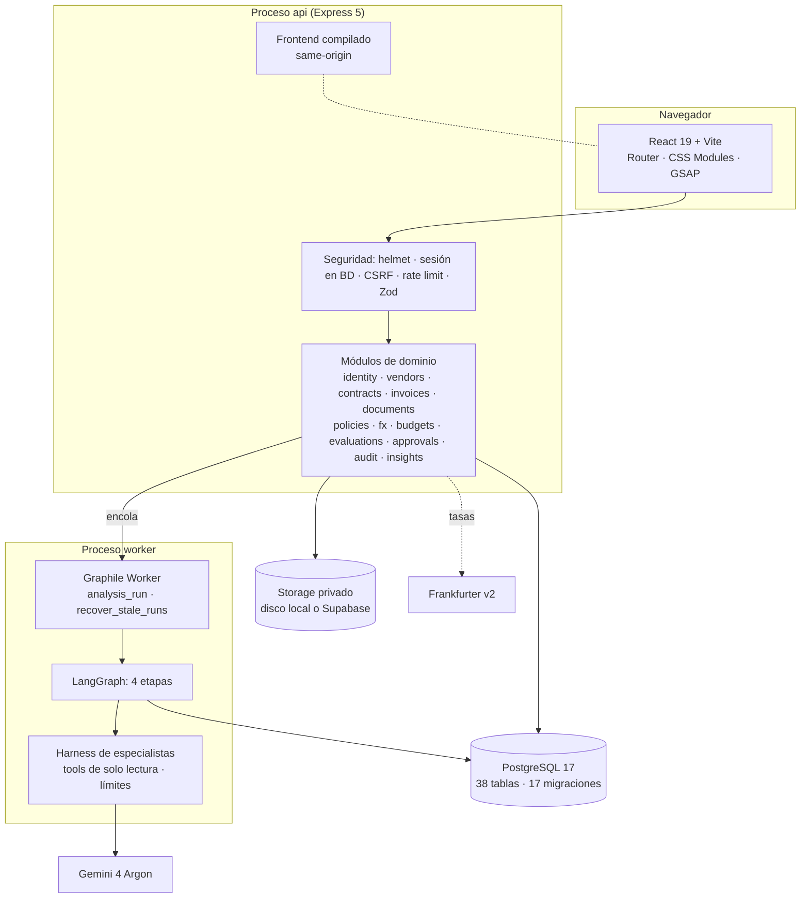
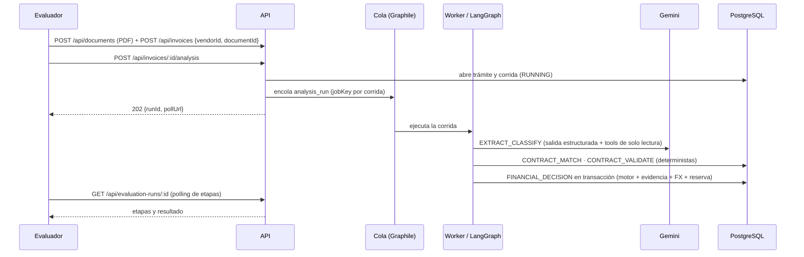

# 02 · Arquitectura

Visión técnica de **Blinka FacturAction**: cómo está organizado, cómo fluye una factura y qué garantías ofrece el diseño. Las decisiones detalladas (D-001 … D-065) están en [`docs/implementation/DECISIONS.md`](../implementation/DECISIONS.md).

## Principios

1. **La IA extrae; las reglas deciden.** El modelo solo propone datos estructurados. La autorización la emite un motor determinista y auditable.
2. **Nada sin evidencia.** Cada valor usado para decidir se localiza en la capa de texto del documento original.
3. **Dinero exacto.** Importes como decimales (`numeric` en PostgreSQL, `decimal.js` en el backend, strings formateados sin coma flotante en el frontend).
4. **Inmutabilidad y trazabilidad.** Versiones, verificaciones, reservas y auditoría no se modifican; cada cambio crea un registro nuevo.
5. **Aislamiento por empresa.** Toda fila lleva `company_id` y las claves foráneas son compuestas `(company_id, id)`.
6. **Simulación explícita.** Pagos, reservas y aprobadores son simulados y así se presentan en la interfaz y la API.

## Vista general



Un mismo código produce dos procesos: **api** (HTTP) y **worker** (cola y agente). Comparten la base de datos; la cola vive en el esquema `graphile_worker` de la misma PostgreSQL (con `LISTEN/NOTIFY`, por eso en Supabase se usa el *Session pooler*).

## Monorepo

```
apps/backend/src/
  server.ts · worker.ts        entrypoints de los dos procesos
  app.ts · api.ts              Express (seguridad, errores) y composición de módulos bajo /api
  composition.ts               servicios compartidos api + worker (FX, evaluación, pipeline, proveedor de IA)
  config/env.ts                entorno validado con Zod; reglas cruzadas de producción
  modules/<dominio>/           schema (Drizzle) · service · routes por dominio
  agents/                      pipeline LangGraph, harness, especialista extractor, proveedores de IA, coste
  jobs/                        catálogo de tareas, cola, handlers (analysis_run, recover_stale_runs)
  integration/                 sondas y guardias para servicios externos
  shared/                      db (cliente, guardias de destino, migraciones, seeds), errores, logger, dinero
apps/web/src/
  app/                         shell, navegación por grupos, router
  pages/                       vistas (facturas, expediente, gestión, auditoría, negocio)
  components/ · lib/           UI base, cliente API, sesión, formato, hooks
```

## Flujo de un análisis



### Las cuatro etapas

| Etapa | Qué hace | IA |
|---|---|---|
| `EXTRACT_CLASSIFY` | Extrae número, fechas, moneda, importes, líneas, cuenta de pago y modalidad. Herramientas permitidas: `get_vendor_profile`, `list_vendor_contract_refs` (solo lectura, limitadas al proveedor de la factura) | **Sí** |
| `CONTRACT_MATCH` | Selecciona el contrato vigente compatible (modalidad, referencia citada) y registra los candidatos descartados | No |
| `CONTRACT_VALIDATE` | Prepara las verificaciones contractuales (tarifas, hitos, líneas de orden, periodo de servicio) | No |
| `FINANCIAL_DECISION` | Verifica evidencia, resuelve el tipo de cambio, aplica políticas y presupuestos y emite la decisión con su reserva, todo en una transacción | No |

Cada etapa queda en `agent_stage_runs` con su **huella de entradas**: una extracción válida se **reutiliza** en reintentos (no se vuelve a pagar la IA) y solo se reintenta la etapa que falló.

### Harness de especialistas

- Documento enviado como **contenido no confiable** (delimitado; el modelo debe ignorar sus instrucciones).
- **Allowlist** de herramientas de solo lectura; cualquier otra (p. ej. `authorize_invoice`, `execute_sql`) se rechaza sin ejecutarse.
- Límites por especialista: pasos (`AI_MAX_STEPS`), tokens (`AI_MAX_TOTAL_TOKENS`), salida (`AI_MAX_OUTPUT_TOKENS`), tiempo (`AI_TIMEOUT_MS`) y concurrencia (`AI_MAX_CONCURRENCY`).
- Salida validada con **Zod**; un único intento de reparación si no cumple el esquema. Campos como `decision` o `approved` se descartan.
- Uso registrado por llamada en `ai_usage_logs` (proveedor, modelo, tokens incluido el pensamiento, coste estimado, latencia, estado), **sin prompts, documentos ni razonamiento**.

Proveedores de IA: `GeminiProvider` (REST `generateContent`, esquema adaptado al subconjunto que acepta Gemini, paso final con herramientas en modo `NONE`) y `FakeAIProvider` (MOCK determinista para desarrollo, pruebas y demo).

## Verificación de evidencia

Al subir un documento se extrae su **capa de texto** (`unpdf`) y se guarda inmutable (`TEXT`, `NO_TEXT` o `UNPARSEABLE`). En la decisión, un verificador determinista busca cada valor (número, fechas, moneda, importes con distintos formatos, cuenta de pago, líneas) en el texto y registra `evaluation_evidence` con página y rango de caracteres:

| Estado | Efecto |
|---|---|
| `TEXT_VERIFIED` | El valor está en el documento |
| `NOT_FOUND` | No aparece → corrección (`EVIDENCE_<CAMPO>`) |
| `UNVERIFIABLE` | Documento sin texto → requiere confirmación humana |
| `HUMAN_CONFIRMED` | Confirmado por una persona (solo si no hay texto) |

Las citas que aporta la IA se guardan aparte como `MODEL_REPORTED` y **nunca cuentan como prueba**.

## Motor de decisión

`DecisionEngine` es una función **pura**: recibe el contexto (versión de la factura, proveedor y cuentas, contrato, políticas, tasa, presupuestos, evidencia) y devuelve verificaciones `PASS / FAIL / UNKNOWN` con su **efecto** (`BLOCK`, `CORRECTION`, `APPROVAL`, `ENABLEMENT`, `ERROR`, `INFO`). La precedencia de efectos determina el resultado visible:

```
ERROR técnico > BLOQUEADA > EN_CORRECCION > EN_APROBACION > AUTORIZADA
```

`EvaluationService` ejecuta el motor dentro de una transacción con bloqueos (factura → presupuesto global → categoría) y, si autoriza, crea la **reserva** con sus dos asignaciones (global y categoría). Restricciones de base de datos garantizan que **no haya sobregiro** y que toda autorización tenga reserva.

Aprobar una solicitud no «fuerza» la autorización: lanza una **reevaluación completa** (FX, contrato, cuenta, políticas y presupuesto se revalidan).

## Modelo de datos

38 tablas en 17 migraciones versionadas (Drizzle + SQL de integridad). Grupos principales:

| Grupo | Tablas |
|---|---|
| Identidad | `companies`, `users`, `company_users`, `auth_sessions`, `rate_limit_buckets` |
| Comercial | `vendors`, `vendor_bank_accounts` (huella HMAC + máscara), `contracts`, `contract_versions`, `contract_items`, `contract_hour_consumptions` |
| Documentos y facturas | `documents`, `document_text_layers`, `document_text_pages`, `invoices`, `invoice_versions`, `invoice_lines`, `invoice_attachments`, `invoice_field_confirmations` |
| Políticas y finanzas | `expense_categories`, `company_policies`, `policy_versions`, `approval_matrix_rules`, `fx_rate_snapshots`, `monthly_budgets`, `budget_reservations`, `budget_reservation_allocations` |
| Evaluación y agente | `evaluation_flows`, `evaluation_runs`, `evaluation_checks`, `evaluation_applied_policies`, `agent_stage_runs`, `evaluation_contract_candidates`, `evaluation_evidence`, `ai_usage_logs` |
| Personas y auditoría | `approval_personas`, `approval_requests`, `audit_events` |

Triggers de inmutabilidad protegen versiones, verificaciones, reservas y auditoría; restricciones `EXCLUDE` (con `btree_gist`) impiden vigencias de contrato solapadas.

## Cola, recuperación y límites

- `analysis_run`: máximo 3 intentos solo ante fallos **transitorios**; errores permanentes cierran la corrida en *Error técnico* sin reintentar.
- `recover_stale_runs` (cron cada 5 min): cierra etapas huérfanas y reencola corridas atascadas (máx. 2), o las cierra como `STALE_RUN`.
- La API limita análisis pendientes por empresa (`ANALYSIS_MAX_PENDING_PER_COMPANY`) y por hora (`ANALYSIS_RATE_LIMIT_PER_HOUR`); rate limit compartido en PostgreSQL, válido con varias instancias.
- Tope opcional de gasto de IA por proceso (`AI_MAX_REQUESTS_PER_PROCESS` + `AI_MAX_COST_USD_PER_PROCESS`), desactivado por defecto.

## API

API REST bajo `/api` (sesión por cookie + token CSRF), documentada en **OpenAPI 3.1**: [`docs/api/openapi.json`](../api/openapi.json) y `GET /openapi.json`. Además: `/health` (proceso vivo) y `/ready` (base de datos disponible).

| Área | Endpoints destacados |
|---|---|
| Sesión | `POST /api/auth/login`, `GET /api/auth/session`, `POST /api/auth/logout` |
| Facturas | `GET/POST /api/invoices`, `GET /api/invoices/:id`, `POST /api/invoices/:id/versions`, `POST /api/invoices/:id/analysis`, `GET /api/invoices/:id/evaluations` |
| Análisis | `GET /api/evaluation-runs/:id` (polling), `GET /api/evaluation-runs/:id/evidence` |
| Documentos | `POST /api/documents`, `GET /api/documents/:id/text`, `GET /api/documents/:id/content` |
| Gestión | proveedores, cuentas, contratos y versiones, políticas, presupuestos y reservas, categorías, personas |
| Aprobaciones | `GET /api/approval-requests`, `POST /api/approval-requests/:id/resolve` |
| Métricas | `GET /api/dashboard`, `GET /api/business-metrics`, `GET /api/ai-usage/summary`, `GET /api/ai-usage`, `GET /api/audit-events` |

## Frontend

- React 19 + Vite + React Router; CSS Modules con tokens de diseño; sin librería de componentes.
- Navegación superior por grupos (Operaciones, Gestión, Auditoría); pestañas del expediente direccionables por URL.
- Cliente API same-origin con cookie de sesión y token CSRF; **sin JWT en `localStorage`**.
- Polling controlado del análisis (pausa con la pestaña oculta, backoff ante errores).
- Movimiento con GSAP solo para eventos reales (avance de etapas, selección de evidencia) y respetando `prefers-reduced-motion`.
- En producción, la API sirve el build compilado en el mismo origen (cookies `SameSite=Strict`).

## Calidad

| Suite | Alcance |
|---|---|
| Backend (Vitest) | Unitarias + integración con PostgreSQL y Graphile reales (≈ 270 pruebas) |
| Frontend (Vitest + Testing Library) | Formato, cliente API, componentes y vistas |
| E2E (Playwright) | Recorridos completos contra backend real en escritorio, tableta y móvil |
| Externas (opt-in) | Frankfurter v2 real (`npm run test:external`); smoke de Gemini acotado (`npm run gemini:smoke`) |
